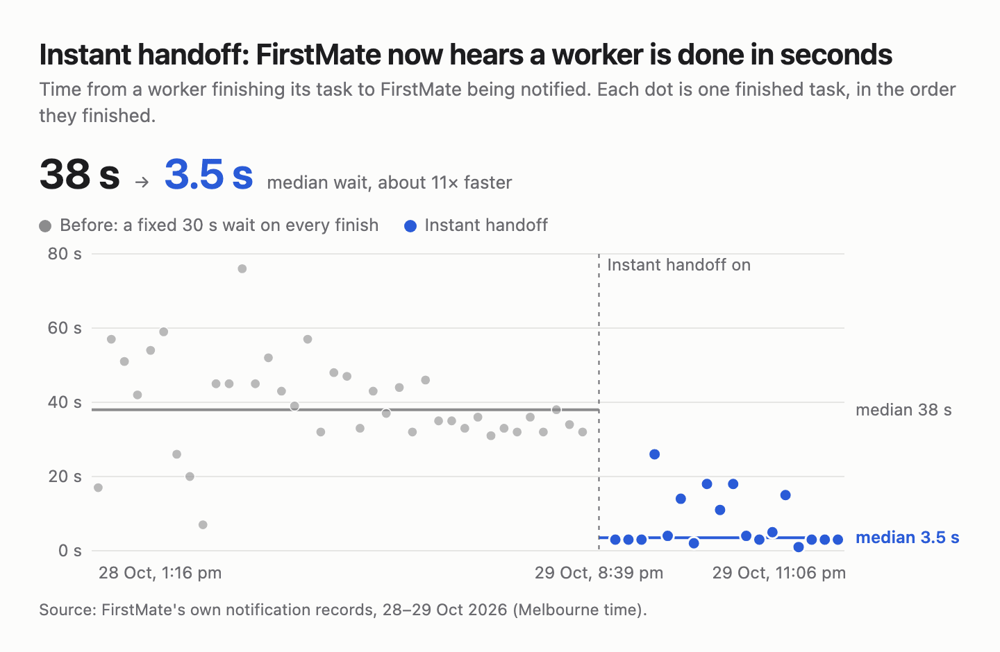
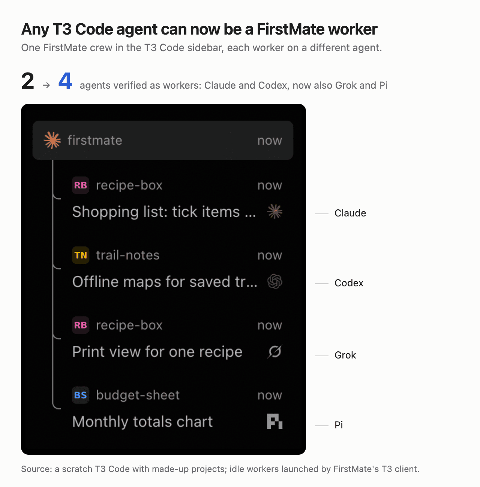
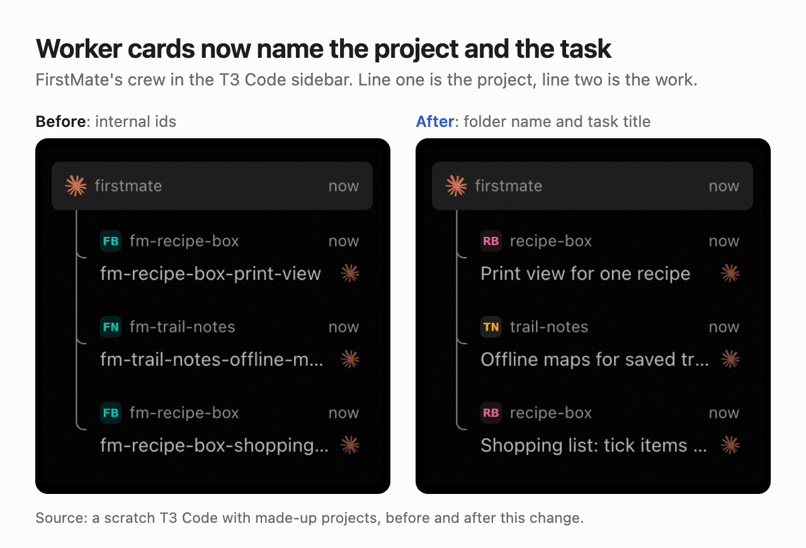
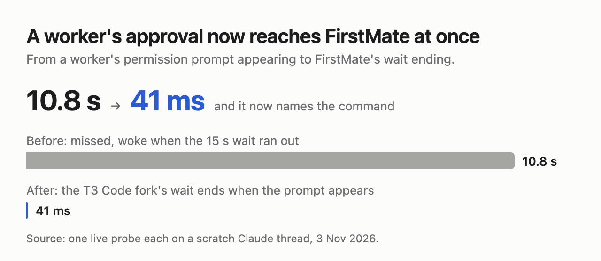
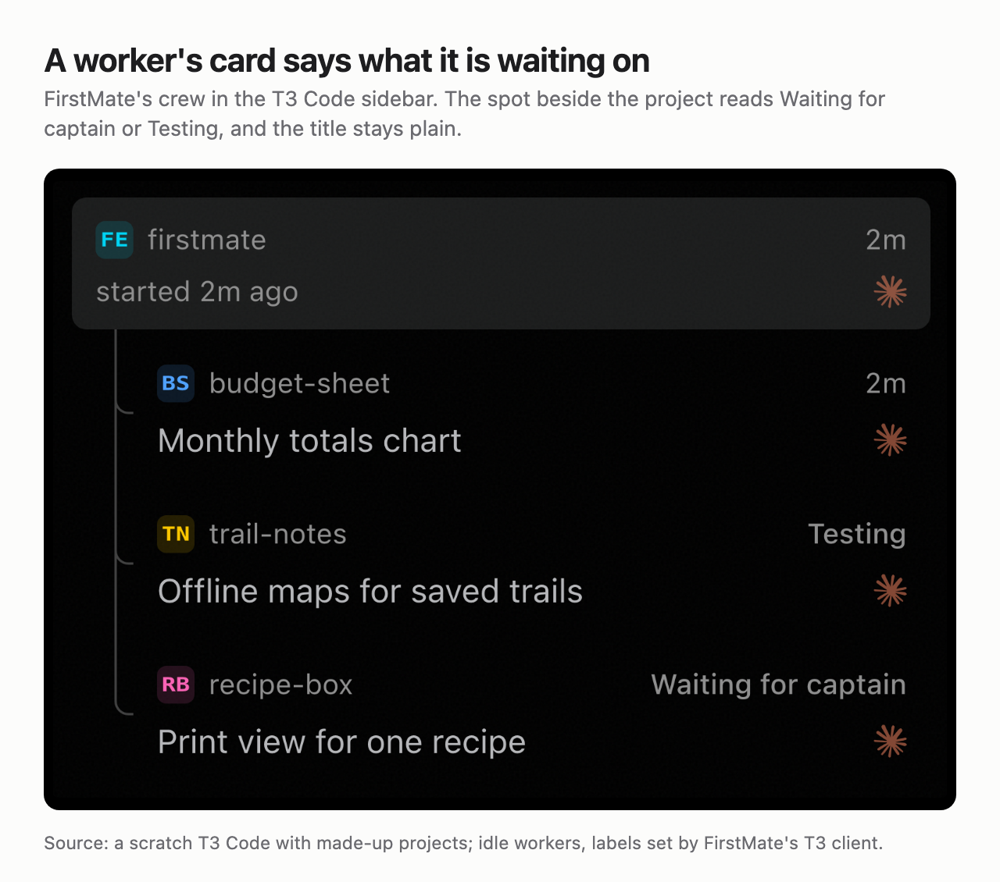
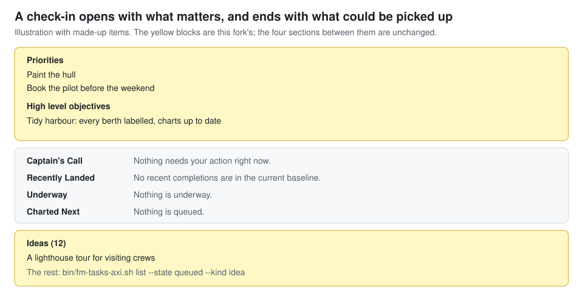
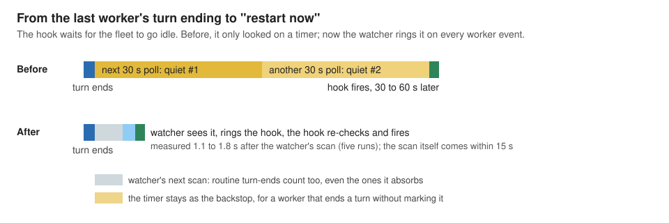

# What this fork adds

This fork of [kunchenguid/firstmate](https://github.com/kunchenguid/firstmate) regularly merges upstream's `main` and carries the changes below on top.
Each section says what the change does and why, with a picture where one shows it.
The [README](README.md) keeps a one-line summary of each, and the [devlog](devlog/index.md) tells how each came about.

## Instant handoff

When a worker reports that it is done, failed, blocked, or needs a decision, FirstMate hears about it within a few seconds of the worker's turn ending, for any agent that marks that end.
Before, every finish waited out a fixed 30-second pause, so a finished worker typically sat unnoticed for 38 seconds.
That pause existed so a worker's last status line and the end of the same turn would cost FirstMate one wake instead of two.
The pause now ends as soon as that turn's end arrives, so the pair still costs one wake.
That part is upstream's own fix, [#7648](https://github.com/kunchenguid/firstmate/pull/7648), which this fork carries ahead of its merge upstream; the next upstream sync reconciles it once #7648 merges or changes.
On T3 Code only Claude marks it, so a Codex, Grok, or other T3 Code worker still waits out the full pause.
A worker's `done` or `failed` also goes straight to FirstMate's own session instead of through the supervision host's extra turn first, which is this fork's part.
Routine `working:` notes keep the pause, where it still saves a wake.
The chart was measured on the fork's earlier version of this change, which #7648 replaced.
Details: [`FM_SIGNAL_GRACE`](docs/configuration.md#environment-variables) and [decision-owned rows](docs/pi-supervision-branch.md#decision-owned-rows).

## Any T3 Code agent can be a worker

On the T3 Code backend, FirstMate used to run only Claude and Codex workers.
Every worker needs its own environment and a note that its instructions really come from FirstMate, and only Claude and Codex could be given those through files in their folder.
Where a T3 Code build supports per-thread environment and instructions, FirstMate now sends both with the thread itself and reads them back to prove they took.
That opens the backend to every agent whose T3 Code driver takes those settings.
Claude, Codex, Grok, and Pi are verified live.
Muse and Antigravity run on their own T3 Code drivers, and Cursor, Gemini, Kimi, and Devin go through the ACP registry, found by agent; those are covered by the test suites only.
OpenCode 2 is refused, because its one shared server gives a thread no environment of its own.
FirstMate now requires the T3 Code fork, which has those settings: a T3 Code without them is refused for every agent, Claude and Codex included, before anything starts, and the folder files are gone.
Dropping stock T3 Code is deliberate.
Upstream keeps the folder files so its experimental backend works on any T3 Code release; this fork ships with the T3 Code fork as one bundle, so keeping a second, weaker path for Claude and Codex would only add code and tests nobody here runs.
A model and an effort are checked against T3 Code's own list for that agent before anything starts, and an effort the model does not offer is refused, never swapped for the nearest one.
Details: [worker environment](docs/t3code-backend.md#worker-environment-and-channel-statement) and [provider instances and models](docs/t3code-backend.md#provider-instances-and-models).

## Workers listed as FirstMate's crew

Each thread FirstMate launches names the FirstMate thread that started it as its parent, so T3 Code lists it as that thread's crew, as in the picture above.
A worker sits under the FirstMate or second mate that spawned it, and a second mate sits under the main FirstMate.
T3 Code used to guess the crew from folder names and `fm-` titles; now the grouping comes from a recorded field.
A thread that does not read back as crew of exactly that parent is archived and refused.
A T3 Code without crew lineage, a FirstMate not running in T3 Code, or a home with several live threads launches the thread with no parent, which changes only the grouping.
Details: [task shape](docs/t3code-backend.md#task-shape-and-metadata).

## Readable project and task titles

A new T3 Code project is titled with its folder name instead of `fm-<folder>`, and a worker's thread is titled with its task's title instead of an internal id.
The worker cards in T3 Code's sidebar then read as the project and the work.
Upstream's `fm-` prefix is there to tell FirstMate's crew apart from the captain's own threads.
The crew lineage described above now does that, so the prefix is no longer needed.
Task titles are cut to 96 characters, so short titles read best.
Projects already in T3 Code keep their old titles, and FirstMate's own records still track each worker by its id, never by the title.
Details: [task lifecycle](docs/t3code-backend.md#current-lifecycle-and-safety).

## Full access and a clean stop

A T3 Code worker is refused unless it runs with full access, because a worker stuck waiting on an approval FirstMate cannot give would stall silently.
A setting T3 Code cannot honour, such as a narrower permission mode or a tool exclusion list, is refused the same way, before anything starts.
Cleanup uses T3 Code's own Stop, which also stops any tasks the worker started itself, instead of leaving them running after the worker is gone.
Details: [task lifecycle](docs/t3code-backend.md#current-lifecycle-and-safety).

## Approvals reach FirstMate at once

When a T3 Code worker stops on a question or a permission approval anyway, FirstMate hears about it at once instead of at the end of its next 15-second wait.
FirstMate can then allow or deny the approval itself, from its own session, instead of interrupting the worker and steering it again.
Upstream treats an approval as a human checkpoint: it is answered only in T3 Code itself, and recovery never answers one.
The fork departs because the captain never deals with workers directly, so FirstMate answers approvals that stay within the worker's task and are not destructive or security-sensitive.
Anything else still comes to the captain as FirstMate's own question.
The T3 Code fork's wait ends the moment a request appears, so FirstMate no longer re-reads idle workers every second, and the 15-second check stays as the backstop.
In a home that also runs Herdr or Rex workers, that other backend keeps the wait, and each 15-second cycle reads the T3 Code workers' requests first, so one still wakes FirstMate within that time.
Details: [push events and polling fallback](docs/t3code-backend.md#push-events-and-polling-fallback).

## Every open decision on T3 Code's Bridge

Each open captain decision is listed on T3 Code's Bridge tab with the question, its options, its project, when it started waiting, and every update FirstMate has made to it since it was raised.
This is an extra track beside chat, not a replacement: as upstream does, FirstMate's chat still lists every open decision as a short line.
Upstream keeps decisions in chat alone; the fork adds the Bridge so each call keeps its full context in one place the captain can open and answer from.
A decision stays under Needs you until it is answered or closed, however long it waits; one deferred to a date waits under Scheduled until that date.
FirstMate sends the whole list in the same step as it changes its own records, so an answered call leaves the Bridge at once, and replying hides it straight away.
A list T3 keeps refusing wakes FirstMate on the third refusal in a row, with T3's exact error.
A T3 Code without the list simply shows no decisions.
Details: [Bridge decisions](docs/t3code-backend.md#bridge-decisions) and [`fm-t3-needs-me.sh`](bin/fm-t3-needs-me.sh).

## The model routing table on T3 Code's Bridge

T3 Code's Bridge tab shows which harness, model, and effort FirstMate picks for each kind of task, read-only, after the decisions: each entry shows the model highlighted with every kind of task routed to it beneath it.
FirstMate builds it from the home's `config/crew-dispatch.json`, grouped by model provider and then family with the default first, reading "Default", and sends it again whenever the file changes.
This is fork-only: upstream has no Bridge, and the dispatch file and how FirstMate chooses from it are unchanged.
The table is only shown, never edited from T3 Code, and a T3 Code without it simply shows none.
Details: [Model routing](docs/t3code-backend.md#model-routing).

## Every standing rule on T3 Code's Bridge

T3 Code's Bridge tab lists every standing rule the captain has given FirstMate, under headings by where it applies, each marked approved or carrying FirstMate's recommendation (keep, keep narrower, make it a rule, fact, or drop).
Tapping a recommendation sends FirstMate one message saying he agrees, and FirstMate records it: the rule is approved or leaves the list, the rules history gets his words, and FirstMate makes any edit the answer needs in the rule's file.
For anything else he copies the rule into chat with his own words.
This is fork-only: upstream has no Bridge and no rule inventory, and FirstMate's approval process for rules is unchanged; the list only shows it.
A T3 Code without the section simply shows none.
Details: [Rules](docs/t3code-backend.md#rules) and [`fm-rules.sh`](bin/fm-rules.sh).

## What the worker is waiting on, on its card

T3 Code knows when a worker's turn ended, but only FirstMate knows whether the worker now needs the captain, sits in a no-mistakes run, waits on something else, or is finished.
FirstMate says so in the status spot on the worker's card, and the title stays as it is.
When FirstMate decides that only the captain can unblock a live worker, the card reads Waiting for captain.
While a worker's no-mistakes run is active, the card reads Testing, and Waiting for captain wins when both apply.
Between turns, a worker with an open question FirstMate settles, a blocker, or a declared pause reads Waiting, finished work reads Ready, and a failure reads Failed.
While the worker works, the card shows T3 Code's own Working, except that Testing stays.
The words change when the worker's state does and go when the worker is cleaned up.
FirstMate keeps no list of its own for this: every update works the label out again from the backlog's holds and each worker's current state, so a failed update, a T3 Code that was down, or a label a restart lost comes right within about a minute.
Only T3 Code workers show this, and it needs a T3 Code with the crew card status; on an older one the card shows none of these words and nothing else changes.
Upstream now reports worker status to terminals that understand it ([#8011](https://github.com/kunchenguid/firstmate/pull/8011), [`fm-osc7501.sh`](bin/fm-osc7501.sh)), including a blocked state for a captain hold, but it never runs on T3 Code, so the two do not meet.
Details: [crew card status](docs/t3code-backend.md#crew-card-status).

## Priorities and high level objectives in every check-in

Bearings and `/ahoy` now open with this home's priorities and then its high level objectives, one short line each, so what to get done and the broad aim of the work are in view whenever FirstMate checks in.
They come from the home's private `data/priorities.md` and `data/high-level-objectives.md`, each a plain bullet list, and a home without one simply shows no block.
A Bearings board stays as it was; the chat digest beside it carries them.
Upstream's Bearings has exactly four sections and `/ahoy` reads only the session history.
The fork keeps both: the two blocks sit above the four sections rather than becoming a fifth, an empty list prints nothing, and `/ahoy` runs one read-only reader for them and nothing else.
With the T3 Code fork, the high level objectives also sit at the top of T3 Code's Bridge tab, above the decisions, and follow the file as it changes.
Details: [`fm-objectives.sh`](bin/fm-objectives.sh) and [Objectives](docs/t3code-backend.md#objectives).

## Ideas in the backlog

The backlog has an `idea` kind for something the captain may pick up, with no work on it yet, so one list answers "what's open".
An idea is never dispatched, never counts as ready, and never reads as waiting on the captain.
Bearings shows them after Charted Next: a count, the newest few, and how to list them all.
Changing an idea's kind turns it into work.
Details: [ideas](docs/configuration.md#ideas).

## Recovery after a T3 Code restart

A T3 Code server restart ends every agent session it hosts at once, including FirstMate's own when it runs inside T3 Code.
The T3 Code fork owns the restart: it resumes the runs it cut where it can, and tells FirstMate's thread, which FirstMate pins as its project's coordinator, that the server restarted and to run session start again.
FirstMate reads the restart from T3's own start time, so it needs no hook of its own on its session, whatever agent runs it.
Session start then reconciles what only FirstMate knows, each worker's last `working:` or `paused:` line.
A worker that has reported since the restart is left alone, and every other working or waiting worker is nudged once to check what is still running and report again.
Until such a worker reports, its last line no longer counts as current.
Details: [server restart](docs/t3code-backend.md#server-restart).

## Do it when no worker is running

An instruction such as "restart when no worker is running" becomes a watch that fires the moment the last worker's turn ends, instead of on a timer.
The watcher rings a doorbell on every worker status write or turn-end it sees, including the routine ones it absorbs, and a watch armed with `--on-worker-event` re-checks at once.
`bin/fm-fleet-idle.sh` is the check: no worker of this home is inside a turn or still has its own work running in its worktree, such as a background test run, with an unreadable worker counted as busy.
The action still fires at most once, and FirstMate gets the outcome as an ordinary wake.
The watch's interval stays as the backstop for a worker whose agent does not mark turn ends.
Details: [the fleet-idle pattern](docs/configuration.md#process-to-event-sources-stateprocevent).

## The live FirstMate's thread on record

Anything that must reach FirstMate, such as an incident listener or a notifier, can read the live session's T3 thread id from `state/t3-main-thread`.
A fixed id went stale, and several FirstMate threads can exist at once.
Only the session holding the session lock writes the record, a read-only session leaves it alone, and a session not running in T3 Code removes a stale one.
Details: [`state/` records](docs/configuration.md#operational-home-layout-and-state).

## The T3 Code credential stays out of transcripts

`config/t3code-token` is a full-access credential, and a T3 Code thread keeps whatever its agent reads.
So in a home signed in to T3 Code, FirstMate's own session is refused any read of that file, a search over `config/`, and a shell command that would print the file or a glob over `config/`.
This guards against a mistake, not a determined reader, and only Claude runs the check.
Details: [`fm-t3-main-pretool-check.sh`](bin/fm-t3-main-pretool-check.sh).

## Current T3 Code releases

T3 Code 0.1.3 renamed some of the tools FirstMate uses and changed how model options are listed.
FirstMate uses only the 0.1.3 tool names, which the T3 Code fork serves, and refuses a T3 Code that offers only the earlier names before anything starts.
Upstream still calls the earlier names, and its open fix [#7851](https://github.com/kunchenguid/firstmate/pull/7851) accepts both; the fork keeps only the new ones, because it ships with the T3 Code fork as one bundle and a second path would only add code and tests nobody here runs.
If #7851 merges upstream, the next upstream sync keeps the fork's single set of names.
Model options listed as a values array rest on [#7864](https://github.com/kunchenguid/firstmate/pull/7864), which this fork carries ahead of its merge upstream; the next upstream sync reconciles it once it merges or changes.
For the same reason, a Claude worker is no longer told to avoid T3 Code's pull-request tools.
Upstream keeps that warning for T3 builds before `0.0.46-nightly.20261010.2935`, on which those tools crashed a Claude session, and the T3 Code fork is far past that build.
Details: [capability gate](docs/t3code-backend.md#capability-gate).

## Telemetry warning that fits the T3 Code fork

The T3 Code fork turns its product telemetry off by default, so a server with no telemetry setting now reads as off and draws no warning.
FirstMate still warns when the server turns telemetry on, or when it cannot read the setting.
Upstream warns unless the server proves telemetry is off, because stock T3 Code has it on by default.
The fork departs because its T3 Code turns telemetry off by default, so a missing setting no longer means on.
Details: [setup](docs/t3code-backend.md#setup).

## No CI by default

The tracked [`.no-mistakes.yaml`](.no-mistakes.yaml) declares `no_ci: true`, so a no-mistakes run does not wait for CI checks.
Upstream runs GitHub Actions on every pull request; GitHub Actions are off on this fork, so no checks would ever register and the run would stall.
The no-mistakes review and the local test and lint steps it runs stand in for CI.
Anyone who clones the fork inherits the setting; turn it off in their copy once they have a live CI.

## Review boards that keep listening

A worker's Lavish review board now keeps listening after it hands the worker a note, so every message the captain sends reaches the worker as soon as it is sent, even while the worker is still working an earlier one.
The worker posts a short acknowledgement on the board as soon as it reads a note, then its full reply when that round is done, and its re-arm acknowledges only the rounds that reply answers.
Upstream runs one batch per round: the listener stops after each round and the worker's reply-carrying re-arm starts the next, likely so one listener and one reply always pair with one round and the older Lavish that can only post a reply with its next poll still works.
The fork departs because that made the board feel unresponsive: anything sent mid-round waited on the board for minutes with no sign it had been seen.
It needs a Lavish that posts replies on their own (0.1.80 and later); on an older one the board keeps upstream's one-batch behavior.
Because the listener stays armed, a worker that ends its own board would be told to conclude a review it just concluded, so an empty session the worker ended itself is filed quietly, as upstream behaves with nothing listening, while one the captain ends still reaches the worker.
Details: [crew-hosted review boards](docs/configuration.md#crew-hosted-lavish-review-boards).

## Rebased local-only work still lands

A `local-only` task whose worker rebased its approved branch onto a newer main now lands, as long as the rebase carries exactly the approved changes.
Upstream records the commit a task reported done at and lands only that commit, so an approval never covers commits added after it, such as unfinished work a worker added after being steered ([#7782](https://github.com/kunchenguid/firstmate/issues/7782)).
The fork departs because it runs many `local-only` workers on one project at once, often with `yolo`: each landing moves main, the other workers rebase as their instructions say, and the rebased commit is no longer the recorded one, so every later landing in the batch was refused and needed a fresh approval for unchanged work.
The fork keeps upstream's intent by landing a rebased branch only when its commits match the approved ones one for one by exact content, in the same order, with no merge commit; commit messages may differ.
An added, amended, reordered, or squashed commit is still refused, and the refusal names the commits that differ.
The approval stays on the commit the task first reported, and the landing records the rebased commit it actually landed.
Approved by the captain on 2026-11-08.
Details: [`fm-merge-local.sh`](bin/fm-merge-local.sh) and the head-latching contract in [`fm-dod-lib.sh`](bin/fm-dod-lib.sh).
