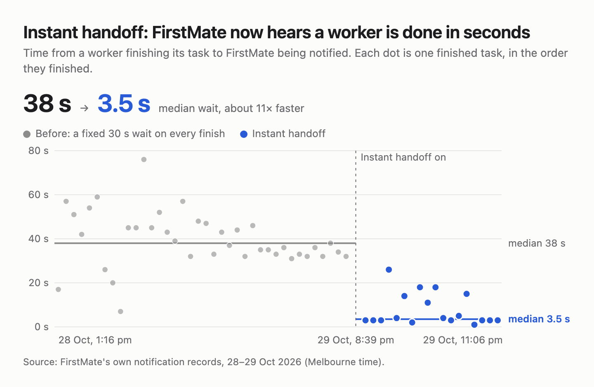
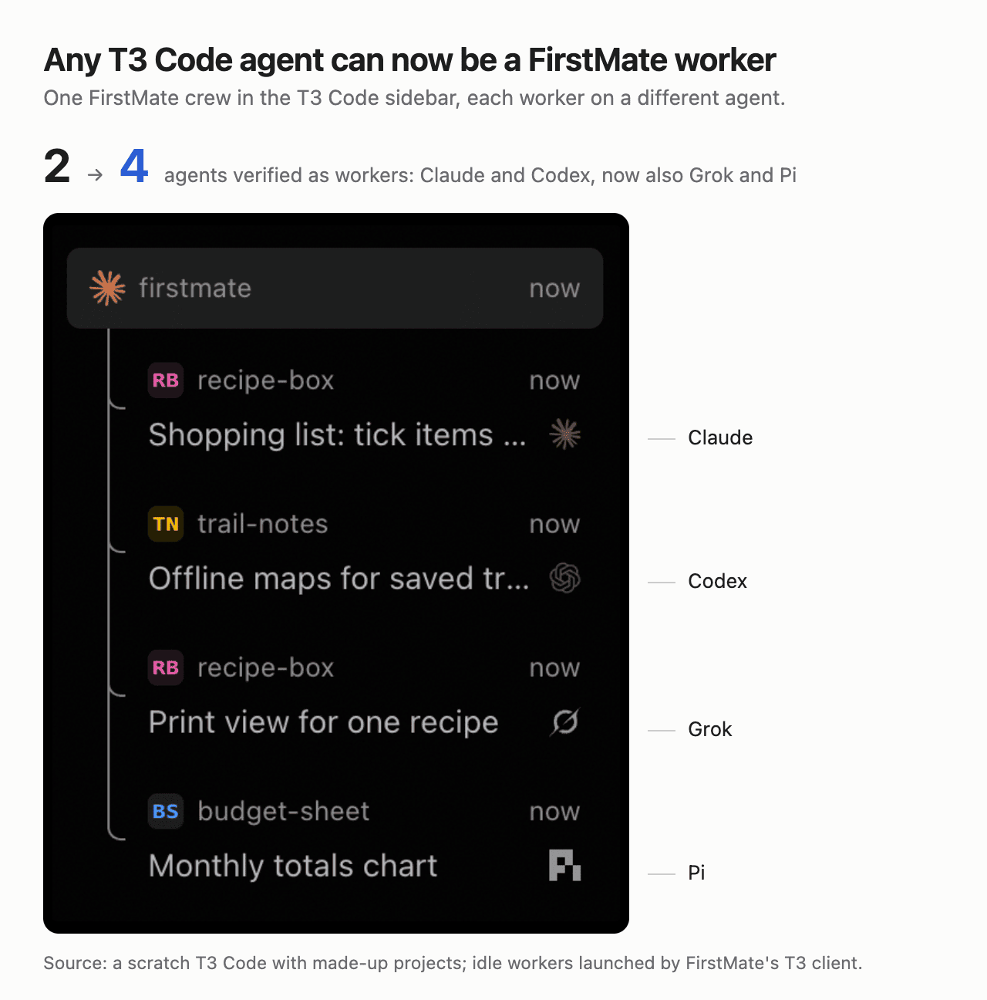
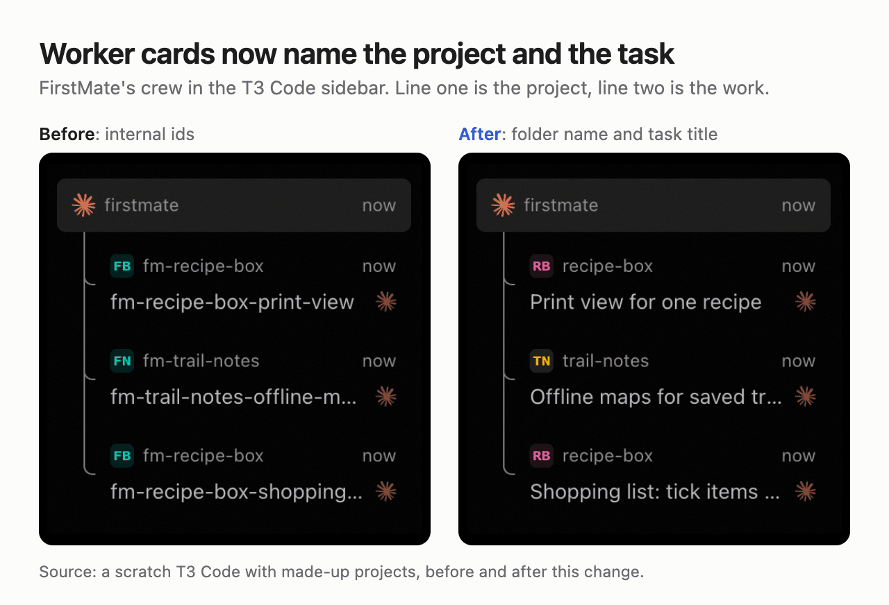
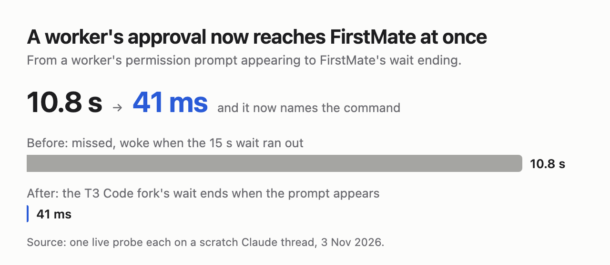
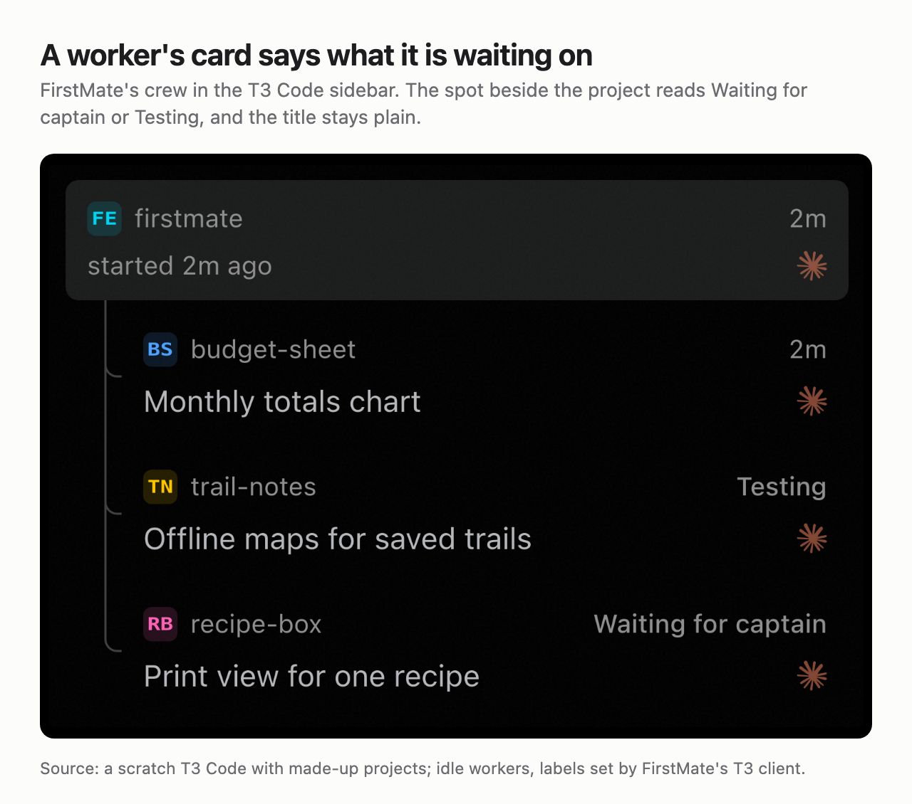
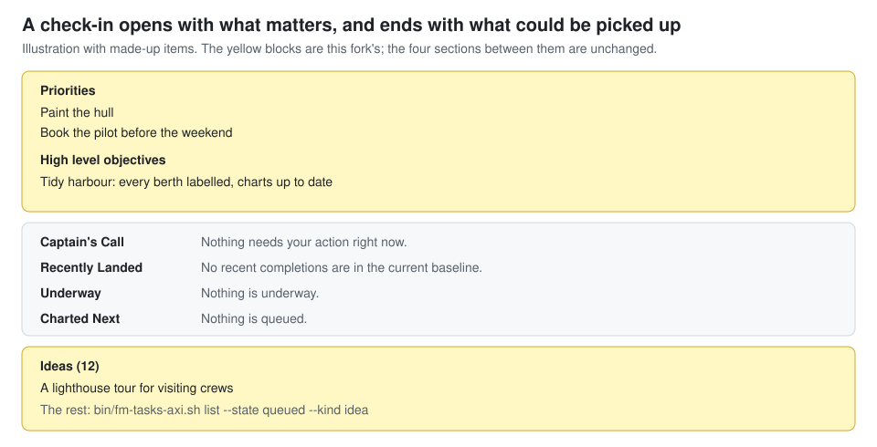
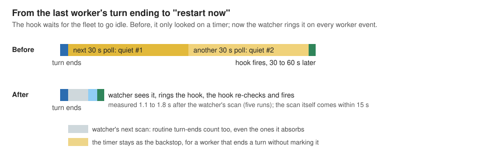

# What this fork adds

This fork of [kunchenguid/firstmate](https://github.com/kunchenguid/firstmate) regularly merges upstream's `main` and carries the changes below on top.
It is for readers who want to know every way this fork differs from upstream.
Each section opens with what the feature does for you, then how and why, with a picture where one shows it.
Each section ends with one credit line saying how much of it upstream already has: none, partly (with the upstream pull requests), or an open pull request that is not merged yet.
Where the [T3 Code fork](https://github.com/dascapytal1559/t3code) carries the other half of a feature, the section links to that half.
The [README](README.md) keeps a one-line summary of each, in the same order, and the [devlog](devlog/index.md) tells how each came about.

## Inside T3 Code

### Instant hand-over

When a worker reports that it is done, failed, blocked, or needs a decision, FirstMate hears about it within a few seconds of the worker's turn ending, instead of about 38 seconds later.
This works for any agent that marks the end of its turn.
Before, every finish waited out a fixed 30-second pause, so a finished worker typically sat unnoticed for 38 seconds.
That pause existed so a worker's last status line and the end of the same turn would cost FirstMate one wake instead of two.
The pause now ends as soon as that turn's end arrives, so the pair still costs one wake.
That part is an outside contributor's open upstream PR, [#7648](https://github.com/kunchenguid/firstmate/pull/7648), which this fork carries ahead of any merge; the next upstream sync reconciles it once #7648 merges or changes.
On T3 Code only Claude marks it, so a Codex, Grok, or other T3 Code worker still waits out the full pause.
A worker's `done` or `failed` also goes straight to FirstMate's own session instead of through the supervision host's extra turn first, which is this fork's part.
Routine `working:` notes keep the pause, where it still saves a wake.
The chart was measured on the fork's earlier version of this change, which #7648 replaced.
Details: [`FM_SIGNAL_GRACE`](docs/configuration.md#environment-variables) and [decision-owned rows](docs/pi-supervision-branch.md#decision-owned-rows).

Upstream: open PR ([#7648](https://github.com/kunchenguid/firstmate/pull/7648), by an outside contributor, not merged) for ending the pause early; none for sending a finish straight to FirstMate.

### Any agent as a worker

Any agent T3 Code can run, not only Claude and Codex, can be one of FirstMate's workers there; Claude, Codex, Grok, and Pi are verified live.
The price is that FirstMate now requires the T3 Code fork: stock T3 Code is no longer supported.
On the T3 Code backend, FirstMate used to run only Claude and Codex workers.
Every worker needs its own environment and a note that its instructions really come from FirstMate, and only Claude and Codex could be given those through files in their folder.
Where a T3 Code build supports per-thread environment and instructions, FirstMate now sends both with the thread itself and reads them back to prove they took.
That opens the backend to every agent whose T3 Code driver takes those settings.
Muse and Antigravity run on their own T3 Code drivers, and Cursor, Gemini, Kimi, and Devin go through the ACP registry, found by agent; those are covered by the test suites only.
OpenCode 2 is refused, because its one shared server gives a thread no environment of its own.
A T3 Code without per-thread settings is refused for every agent, Claude and Codex included, before anything starts, and the folder files are gone.
Dropping stock T3 Code is deliberate.
Upstream keeps the folder files so its experimental backend works on any T3 Code release; this fork ships with the T3 Code fork as one bundle, so keeping a second, weaker path for Claude and Codex would only add code and tests nobody here runs.
A model and an effort are checked against T3 Code's own list for that agent before anything starts, and an effort the model does not offer is refused, never swapped for the nearest one.
Details: [worker environment](docs/t3code-backend.md#worker-environment-and-channel-statement) and [provider instances and models](docs/t3code-backend.md#provider-instances-and-models).

Upstream: partly ([#7518](https://github.com/kunchenguid/firstmate/pull/7518): Claude and Codex workers only).
T3 Code fork half: [Any agent as a worker](https://github.com/dascapytal1559/t3code/blob/main/fork/README.md#any-agent-as-a-worker).

### Workers listed as crew

T3 Code's sidebar lists each worker under the FirstMate that started it, as in the picture above, because FirstMate records that parent on every thread it launches.
A worker sits under the FirstMate or second mate that spawned it, and a second mate sits under the main FirstMate.
T3 Code used to guess the crew from folder names and `fm-` titles; now the grouping comes from a recorded field.
A thread that does not read back as crew of exactly that parent is archived and refused.
A T3 Code without crew lineage, a FirstMate not running in T3 Code, or a home with several live threads launches the thread with no parent, which changes only the grouping.
Details: [task shape](docs/t3code-backend.md#task-shape-and-metadata).

Upstream: none.
T3 Code fork half: [Crew in the sidebar](https://github.com/dascapytal1559/t3code/blob/main/fork/README.md#crew-in-the-sidebar).

### Readable titles

Worker cards in T3 Code's sidebar read as the project and the work, such as "recipe-box" over "Print view for one recipe", instead of internal `fm-` ids.
A new T3 Code project is titled with its folder name instead of `fm-<folder>`, and a worker's thread is titled with its task's title instead of an internal id.
Upstream's `fm-` prefix is there to tell FirstMate's crew apart from the captain's own threads.
The crew lineage described above now does that, so the prefix is no longer needed.
Task titles are cut to 96 characters, so short titles read best.
Projects already in T3 Code keep their old titles, and FirstMate's own records still track each worker by its id, never by the title.
Details: [task lifecycle](docs/t3code-backend.md#current-lifecycle-and-safety).

Upstream: none.
T3 Code fork half: [Crew in the sidebar](https://github.com/dascapytal1559/t3code/blob/main/fork/README.md#crew-in-the-sidebar).

### Full access and a clean stop

Workers always run at full access, so none stalls silently on an approval, and cleaning up a worker stops everything it started.
A T3 Code worker is refused unless it runs with full access, because a worker stuck waiting on an approval FirstMate cannot give would stall silently.
A setting T3 Code cannot honour, such as a narrower permission mode or a tool exclusion list, is refused the same way, before anything starts.
Cleanup uses T3 Code's own Stop, which also stops any tasks the worker started itself, instead of leaving them running after the worker is gone.
Full access and refusing settings T3 Code cannot honour are upstream's; the clean stop is this fork's, since upstream refuses to stop a T3 Code worker.
Details: [task lifecycle](docs/t3code-backend.md#current-lifecycle-and-safety).

Upstream: partly ([#7518](https://github.com/kunchenguid/firstmate/pull/7518) for full access, [#8223](https://github.com/kunchenguid/firstmate/pull/8223) for the tool exclusion refusal).

### Approvals at once

When a T3 Code worker stops on a question or a permission approval, FirstMate hears about it in milliseconds instead of at the end of its next 15-second wait.
FirstMate can then allow or deny the approval itself, from its own session, instead of interrupting the worker and steering it again.
Upstream treats an approval as a human checkpoint: it is answered only in T3 Code itself, and recovery never answers one.
The fork departs because the captain never deals with workers directly, so FirstMate answers approvals that stay within the worker's task and are not destructive or security-sensitive.
Anything else still comes to the captain as FirstMate's own question.
The T3 Code fork's wait ends the moment a request appears, so FirstMate no longer re-reads idle workers every second, and the 15-second check stays as the backstop.
In a home that also runs Herdr or Rex workers, that other backend keeps the wait, and each 15-second cycle reads the T3 Code workers' requests first, so one still wakes FirstMate within that time.
Details: [push events and polling fallback](docs/t3code-backend.md#push-events-and-polling-fallback).

Upstream: none.
T3 Code fork halves: [Approvals reach FirstMate at once](https://github.com/dascapytal1559/t3code/blob/main/fork/README.md#approvals-reach-firstmate-at-once) and [FirstMate answers approvals](https://github.com/dascapytal1559/t3code/blob/main/fork/README.md#firstmate-answers-approvals).

### Routing table on the Bridge

T3 Code's Bridge tab shows which harness, model, and effort FirstMate picks for each kind of task, so you can see the routing without opening a config file.
It is read-only and sits after the objectives: each entry shows the model highlighted with every kind of task routed to it beneath it.
FirstMate builds it from the home's `config/crew-dispatch.json`, grouped by model family with the default first, reading "Default", and sends it again whenever the file changes.
The dispatch file and how FirstMate chooses from it are unchanged.
The table is only shown, never edited from T3 Code, and a T3 Code without it simply shows none.
Details: [Model routing](docs/t3code-backend.md#model-routing).

Upstream: none; upstream has no Bridge.
T3 Code fork half: [Bridge](https://github.com/dascapytal1559/t3code/blob/main/fork/README.md#bridge).

### Card status

Each worker's card in T3 Code's sidebar says what the worker is waiting on: Waiting for captain, Testing, Waiting, Ready, or Failed.
T3 Code knows when a worker's turn ended, but only FirstMate knows whether the worker now needs the captain, sits in a no-mistakes run, waits on something else, or is finished.
FirstMate says so in the status spot on the worker's card, and the title stays as it is.
When FirstMate decides that only the captain can unblock a live worker, the card reads Waiting for captain.
While a worker's no-mistakes run is active, the card reads Testing, and Waiting for captain wins when both apply.
Between turns, a worker with an open question FirstMate settles, a blocker, or a declared pause reads Waiting, finished work reads Ready, and a failure reads Failed.
While the worker works, the card shows T3 Code's own Working, except that Testing stays.
The words change when the worker's state does and go when the worker is cleaned up.
FirstMate keeps no list of its own for this: every update works the label out again from the backlog's holds and each worker's current state, so a failed update, a T3 Code that was down, or a label a restart lost comes right within about a minute.
Only T3 Code workers show this, and it needs a T3 Code with the crew card status; on an older one the card shows none of these words and nothing else changes.
Upstream shows similar FirstMate-derived status on Herdr's project groups and reports worker status to terminals that understand it ([`fm-osc7501.sh`](bin/fm-osc7501.sh)), including a blocked state for a captain hold, but neither runs on T3 Code, so they do not meet; the T3 Code card, the Testing label, and working the label out from current state are this fork's.
Details: [crew card status](docs/t3code-backend.md#crew-card-status).

Upstream: partly ([#7434](https://github.com/kunchenguid/firstmate/pull/7434) on Herdr, [#8011](https://github.com/kunchenguid/firstmate/pull/8011) in terminals; neither on T3 Code).
T3 Code fork half: [Crew in the sidebar](https://github.com/dascapytal1559/t3code/blob/main/fork/README.md#crew-in-the-sidebar).

### Reply on a worker's thread

When the captain replies on a worker's thread, or settles or snoozes it, FirstMate gets that as the captain's input on that worker's task.
The T3 Code fork has no message box that types into a worker; a box on a worker's thread forwards the captain's words to FirstMate's chat instead, so the captain can reply while reading a worker's exploration.
FirstMate reads which worker's task the message belongs to and treats the captain's words as input on that task.
Upstream T3 Code sends anything typed in a thread to that thread's agent, which is right for threads the captain talks to directly.
The fork departs for FirstMate's workers because a message typed into one cuts across FirstMate's steering, and FirstMate is the one who records the captain's answers.
Settling, un-settling, snoozing, or un-snoozing a worker's thread sends FirstMate the same kind of message, so FirstMate closes, reopens, parks, or un-parks the matching backlog item and the records stay in sync with what the captain sees.
Details: [replies from a worker's thread](docs/t3code-backend.md#replies-from-a-workers-thread) and [`fm-t3-worker-reply.sh`](bin/fm-t3-worker-reply.sh).

Upstream: none.
T3 Code fork halves: [Reply box goes to FirstMate](https://github.com/dascapytal1559/t3code/blob/main/fork/README.md#reply-box-goes-to-firstmate) and [Settle, never archive](https://github.com/dascapytal1559/t3code/blob/main/fork/README.md#settle-never-archive).

### Restart recovery

FirstMate's own session runs in T3 Code, and after a T3 Code restart it takes the helm again and nudges every worker the restart cut off.
A T3 Code server restart ends every agent session it hosts at once, including FirstMate's own when it runs inside T3 Code.
The T3 Code fork owns the restart: it resumes the runs it cut where it can, and tells FirstMate's thread, which FirstMate pins as its project's coordinator, that the server restarted and to run session start again.
FirstMate reads the restart from T3's own start time, so it needs no hook of its own on its session, whatever agent runs it.
Session start then reconciles what only FirstMate knows, each worker's last `working:` or `paused:` line.
A worker that has reported since the restart is left alone, and every other working or waiting worker is nudged once to check what is still running and report again.
Until such a worker reports, its last line no longer counts as current.
Details: [server restart](docs/t3code-backend.md#server-restart).

Upstream: none.
T3 Code fork half: [Clean restarts](https://github.com/dascapytal1559/t3code/blob/main/fork/README.md#clean-restarts).

### A usage limit never stops the work

A worker stopped by an account's usage limit is moved to another account at once and carries on in the same conversation, instead of sitting stopped until someone notices.
FirstMate used to hear only that a worker had gone quiet, the supervision session filed it as routine, and FirstMate's own steer refused the stopped thread as if its agent had exited.
Now a stopped thread takes a steer like any other, since T3 Code continues the same conversation on a new message.
The watcher reads why the run failed, using T3's typed failure fields when it has them and otherwise the run's "Usage limit reached" error and Claude's limit notice, and raises one notification per stopped run naming the account, the limit, and its reset time.
That notification goes to FirstMate itself, never only to the supervision session, and the stuck-worker playbook and the supervision session's instructions both say a usage-limit stop is acted on or escalated, never filed as routine.
FirstMate moves the worker at once with `bin/fm-usage-limit.sh move`, which checks the other account offers the same model and effort, rebinds the thread there, reads the binding back, records the move, and sends the continuation through the ordinary steer.
Which account to move to stays FirstMate's choice under the captain's account rules, and a moved worker finishes where it is; only new work goes back.
When the captain says an account was reset early, `bin/fm-usage-limit.sh resume <account>` rings every worker still stopped on it; nothing detects such a reset on its own.
T3 Code's own "Resume after usage limits" setting stays the backstop for the natural reset, when no account has room or FirstMate itself was down.
Moving across accounts hands the conversation over trimmed, so a worker deep in an investigation can lose some of its thread; its brief, status, and files are untouched.
Outside contributors' open upstream PRs head the same way by relaunching a fresh worker on another profile; moving the same T3 Code thread without losing its conversation is this fork's.
Approved by the captain on 2026-11-15.
Details: [usage-limit stops](docs/t3code-backend.md#usage-limit-stops).

Upstream: open PRs ([#7748](https://github.com/kunchenguid/firstmate/pull/7748) and [#8370](https://github.com/kunchenguid/firstmate/pull/8370), each by an outside contributor, not merged), which relaunch a fresh worker instead.

### Clean T3 restarts

Installing a new T3 build restarts T3 only once every running turn has finished, so no worker or FirstMate turn is cut off mid-way.
Installing first asks T3 for the restart through the T3 Code fork's restart registry, once no worker is busy.
T3 shows the captain the coming restart, holds new messages, and lets every running turn finish, FirstMate's own included; the install starts only when T3 reports drained.
A wait past its limit, or a stopped install, cancels the request so no message stays held.
Details: [clean restart](docs/t3code-backend.md#clean-restart).

Upstream: none; upstream T3 Code has no restart registry.
T3 Code fork half: [Clean restarts](https://github.com/dascapytal1559/t3code/blob/main/fork/README.md#clean-restarts).

### Long commands survive restarts

A worker's long test run or build keeps going through a T3 Code restart, and its result still reaches the worker.
A worker's long command, such as a broad test sweep or a long build, runs as a detached job outside the worker's own session, and the worker watches its output for up to nine minutes, so T3 shows the command and its output as upstream does and the worker reads as working.
If the job is still running when the watch ends by itself, the worker declares a wait and ends its turn, and the result comes back to it as an instruction that starts its next turn when the job finishes.
If a restart cuts the watch, the job keeps running and the restart recovery tells the worker to re-attach from the log's last lines.
Upstream has a worker run such a command in its own turn or a background shell and declare the wait, and sets that wait to the job's timeout; outside contributors have open upstream PRs that wake a worker when its job finishes; surviving a restart is this fork's.
The fork departs because a T3 Code restart ends every agent session with its background commands, so a long test run was cut by each new build.
The job itself is left out of the busy count, but a worker watching it is a running turn, so a clean restart waits for the watch to end, which is never more than about nine minutes.
A plain cleanup refuses while a job runs and only an explicit discard stops it.
A worker's instructions tell it to run anything longer than a few minutes as a job.
Details: [`fm-job.sh`](bin/fm-job.sh) and [server restart](docs/t3code-backend.md#server-restart).

Upstream: partly ([#7240](https://github.com/kunchenguid/firstmate/pull/7240) sets a declared wait to the job's timeout); open PRs ([#7098](https://github.com/kunchenguid/firstmate/pull/7098) and [#7849](https://github.com/kunchenguid/firstmate/pull/7849), each by an outside contributor, not merged) wake a worker when its job finishes.

### Fresh sessions take over

After `/clear` in T3 Code, the new FirstMate session takes the helm on the same thread instead of coming up read-only beside the old one.
`/clear` starts FirstMate's next message in a fresh session on the same thread.
The new session takes the helm through the ordinary session start: it reclaims the ended session's lock and keeps the same thread on record.
Reclaiming a dead session's lock is upstream's own [`fm-lock.sh`](bin/fm-lock.sh); the T3 Code side and the thread record are this fork's, since upstream's FirstMate does not yet run as a T3 Code thread.
If the old process is somehow still running, the new session says so and names the remedy instead of taking over beside it.
Details: [fresh session with /clear](docs/t3code-backend.md#fresh-session-with-clear).

Upstream: partly (reclaiming a dead session's lock in [`fm-lock.sh`](bin/fm-lock.sh)).
T3 Code fork half: [A fresh start really ends the old one](https://github.com/dascapytal1559/t3code/blob/main/fork/README.md#a-fresh-start-really-ends-the-old-one).

### Auto clearing on a notification

When a worker's notification arrives for a FirstMate session that has sat idle past its cache lifetime, FirstMate starts fresh instead of reloading that cold, expensive session.
Upstream wakes the main session in place when a worker needs it and treats that session as long-lived.
For the cost of an idle one it compacts the session while its cache is still warm, because where upstream runs FirstMate there is no way to restart the main session from a script ([#7755](https://github.com/kunchenguid/firstmate/issues/7755)).
In a T3 Code thread there is: a fresh session on the same thread, which this fork already hands over cleanly.
So when a notification would wake a session that has sat idle past the cache lifetime, the fork rings it through T3 Code instead, and T3 Code starts a fresh session.
Any failure falls back to upstream's wake, and outside a T3 Code thread nothing changes.
Approved by the captain on 2026-11-15.
Only a session over 100k tokens is rung this way, since a small one reloads for about the price of a fresh start.
The message carries no notification itself: the notification stays queued, and the fresh session's start digest presents it.
It travels as Firstmate operational input, a doorbell naming a record in this home's inbox, so the away-mode return rule, the dialog mirror, and the nightly clear check never take it for the captain's words.
Upstream's Stop hook is unchanged; the fork wraps it, and its StopFailure registration still runs it directly.
It needs the T3 Code fork's rule that starts a cold FirstMate thread fresh; without that rule the message only reaches the old session.
Details: [`fm-claude-stop-cold-reroute.sh`](bin/fm-claude-stop-cold-reroute.sh).

Upstream: none; it compacts an idle session instead ([#7807](https://github.com/kunchenguid/firstmate/pull/7807)).
T3 Code fork half: [Auto clearing (cold clear)](https://github.com/dascapytal1559/t3code/blob/main/fork/README.md#auto-clearing-cold-clear).

### Nightly clear check

Each night a check lists every clear of FirstMate's session and puts a line in the morning briefing when one may have lost the thread of a conversation.
Clearing FirstMate's main session saves most of what its long context costs, but a fresh session can lose the thread of a conversation.
So a nightly script reads FirstMate's own session transcripts, with no model call, and lists every clear of the day: its cause (the captain's `/clear`, a cold start from a message, a cold start from a notification, or a T3 restart), the context it dropped, and any sign of harm in the new session's first hour.
The signs are a bare short reply, a recall phrase, a quote of the previous session, an answered decision asked again, a task dispatched twice, a notification left unacknowledged across the clear, and FirstMate not back at the helm within minutes of an automatic clear.
It writes one line into that morning's briefing only when a sign shows, and a weekly total on Mondays.
It reads Claude transcripts only, and runs once a night as a step of [`fm-nightly-checks.sh`](bin/fm-nightly-checks.sh) from the host's scheduler.
Details: [`fm-clear-watch.py`](bin/fm-clear-watch.py).

Upstream: none; upstream does not clear FirstMate's session on its own.

### Nightly usage-labels check

Each night a check raises one backlog item when any of the previous day's T3 Code usage is not labelled as phone or computer, or when that figure cannot be read.
T3 Code's Usage page counts each token to the phone or the computer, and a token with no evidence of either counts to the computer only by default.
Such a gap used to surface only when someone noticed odd numbers on that page.
So the nightly checks also read the T3 Code fork's labels watchdog for the previous day, with no model call, and raise one backlog item naming each unlabelled reason, provider, and token count.
The same item also counts that day's failed usage claims, because a wake turn FirstMate failed to name counts as upkeep on the computer, which the watchdog cannot tell from real upkeep.
If the watchdog cannot be read, that is the item instead, because an unreadable figure is unknown, not zero; a fully labelled day raises nothing.
Later nights update the same item rather than adding another.
It needs a T3 Code build with the watchdog (`t3_usage_reasons`); on an older build every night raises the unreadable item.
Details: [`fm-usage-labels-check.sh`](bin/fm-usage-labels-check.sh).

Upstream: none.
T3 Code fork half: [Phone vs computer split](https://github.com/dascapytal1559/t3code/blob/main/fork/README.md#phone-vs-computer-split).

### Pointer to the previous dialog

A fresh FirstMate session is told where the previous session's conversation is saved, and reads it only when the captain's first message needs it.
A fresh FirstMate session, after an automatic clear or the captain's own `/clear`, starts with no earlier context.
Upstream already records the captain's prompts and FirstMate's final replies for its supervision host, and treats a restart as a non-event; that dialog record is upstream's, and the pointer below is this fork's.
The fork's session start adds one short `PREVIOUS DIALOG` section that names that saved dialog and a command that prints its newest entries, and says to read it only when the captain's first message seems to answer or refer to something it does not quote.
It does not carry the dialog itself: the captain usually replies by quoting a message, and T3 Code puts the quoted text into that message, so the dialog is rarely needed, and carrying it cost about 1,900 tokens at every session start.
It prints nothing when no earlier session was recorded, so it needs a primary whose dialog upstream records, Claude or Cursor, with the supervision host on.
Approved by the captain on 2026-11-15, with the automatic clearing above, and changed from carrying the last exchange to this pointer on 2026-11-17 at the captain's request.
Details: [the dialog mirror](docs/supervision-host.md#the-dialog-mirror) and [`fm-host-mirror.sh`](bin/fm-host-mirror.sh).

Upstream: partly ([#5707](https://github.com/kunchenguid/firstmate/pull/5707) records the dialog).
T3 Code fork half: [Auto clearing (cold clear)](https://github.com/dascapytal1559/t3code/blob/main/fork/README.md#auto-clearing-cold-clear).

### Alerts only when needed

A FirstMate turn that nobody typed into ends quietly unless it has something the captain must see at once.
The T3 Code fork ends a turn with the alert sound only when the captain's own message started it or was sent into it, so a turn that a notification, a background wake, or another agent's message started ends quietly, since most of FirstMate's turns are supervision.
So when such a quiet turn ends with something that must reach the captain at once, FirstMate flags that turn to alert as usual.
A session outside T3 Code, a read-only session, and a second mate are told nothing about it.
Details: [`t3-thread.md`](docs/supervision-protocols/t3-thread.md).

Upstream: none; upstream's FirstMate does not run as a T3 Code thread.
T3 Code fork half: [Quiet workers, quiet wakes](https://github.com/dascapytal1559/t3code/blob/main/fork/README.md#quiet-workers-quiet-wakes).

### Work records its cause

Each piece of work names the T3 Code thread it comes from, and when, so T3 Code's Usage page can count it to the device of the latest typed message on that work.
FirstMate names that thread when it launches a worker, steers one, files a note, queues an item, or claims a wake turn, and T3 Code turns it into the label; FirstMate no longer decides the cause itself.
This is an addition that only a T3 Code with the field uses.
Details: [where work comes from](docs/t3code-backend.md#where-work-comes-from).

Upstream: none.
T3 Code fork half: [Work records its cause](https://github.com/dascapytal1559/t3code/blob/main/fork/README.md#work-records-its-cause).

### Live thread on record

Anything that must reach FirstMate, such as an incident listener or a notifier, can find the live FirstMate's T3 Code thread.
It reads the live session's T3 thread id from `state/t3-main-thread`.
A fixed id went stale, and several FirstMate threads can exist at once.
Only the session holding the session lock writes the record, a read-only session leaves it alone, and a session not running in T3 Code removes a stale one.
Details: [`state/` records](docs/configuration.md#operational-home-layout-and-state).

Upstream: none.

### Credential guard

FirstMate's own session cannot read the T3 Code password file, so that credential never lands in a transcript.
`config/t3code-token` is a full-access credential, and a T3 Code thread keeps whatever its agent reads.
So in a home signed in to T3 Code, FirstMate's own session is refused any read of that file, a search over `config/`, and a shell command that would print the file or a glob over `config/`.
This guards against a mistake, not a determined reader, and only Claude runs the check.
Details: [`fm-t3-main-pretool-check.sh`](bin/fm-t3-main-pretool-check.sh).

Upstream: none.

### Current T3 releases

FirstMate works with current T3 Code releases from 0.1.3 on, which the T3 Code fork serves, and refuses an older T3 Code before anything starts.
T3 Code 0.1.3 renamed some of the tools FirstMate uses and changed how model options are listed.
FirstMate uses only the 0.1.3 tool names and refuses a T3 Code that offers only the earlier names.
Upstream still calls the earlier names; outside contributors' open PRs accept both, while the fork keeps only the new ones, because it ships with the T3 Code fork as one bundle and a second path would only add code and tests nobody here runs.
If one of those PRs merges upstream, the next upstream sync keeps the fork's single set of names.
Model options listed as a values array rest on [#7864](https://github.com/kunchenguid/firstmate/pull/7864), an outside contributor's open PR which this fork carries ahead of any merge; the next upstream sync reconciles it once it merges or changes.
For the same reason, a Claude worker is no longer told to avoid T3 Code's pull-request tools.
Upstream keeps that warning for T3 builds before `0.0.46-nightly.20261010.2935`, on which those tools crashed a Claude session, and the T3 Code fork is far past that build.
Details: [capability gate](docs/t3code-backend.md#capability-gate).

Upstream: open PRs ([#7851](https://github.com/kunchenguid/firstmate/pull/7851), [#7864](https://github.com/kunchenguid/firstmate/pull/7864), [#8009](https://github.com/kunchenguid/firstmate/pull/8009), [#8235](https://github.com/kunchenguid/firstmate/pull/8235), and [#8475](https://github.com/kunchenguid/firstmate/pull/8475), each by an outside contributor, not merged).

### Telemetry warning

FirstMate warns about T3 Code's product telemetry only when it is on or cannot be read, since the T3 Code fork turns it off by default.
A server with no telemetry setting now reads as off and draws no warning.
FirstMate still warns when the server turns telemetry on, or when it cannot read the setting.
Upstream warns unless the server proves telemetry is off, because stock T3 Code has it on by default.
Details: [setup](docs/t3code-backend.md#setup).

Upstream: none.
T3 Code fork half: [Telemetry off](https://github.com/dascapytal1559/t3code/blob/main/fork/README.md#telemetry-off).

## Outside T3 Code

### Priorities and objectives

Every check-in, Bearings and `/ahoy`, opens with this home's priorities and then its high level objectives, one short line each, so what to get done and the broad aim of the work are in view whenever FirstMate checks in.
They come from the home's private `data/priorities.md` and `data/high-level-objectives.md`, each a plain bullet list, and a home without one simply shows no block.
A Bearings board stays as it was; the chat digest beside it carries them.
Upstream's Bearings has exactly four sections and `/ahoy` reads only the session history.
The fork keeps both: the two blocks sit above the four sections rather than becoming a fifth, an empty list prints nothing, and `/ahoy` runs one read-only reader for them and nothing else.
With the T3 Code fork, the high level objectives also sit at the top of T3 Code's Bridge tab and follow the file as it changes.
Details: [`fm-objectives.sh`](bin/fm-objectives.sh) and [Objectives](docs/t3code-backend.md#objectives).

Upstream: none.
T3 Code fork half: [Bridge](https://github.com/dascapytal1559/t3code/blob/main/fork/README.md#bridge).

### Ideas in the backlog

The backlog keeps ideas the captain may pick up apart from work, so one list answers "what's open" without an idea ever being started by mistake.
The backlog has an `idea` kind for something the captain may pick up, with no work on it yet.
An idea is never dispatched, never counts as ready, and never reads as waiting on the captain.
Bearings shows them after Charted Next: a count, the newest few, and how to list them all.
Changing an idea's kind turns it into work.
Details: [ideas](docs/configuration.md#ideas).

Upstream: none.

### "When no worker is running"

An instruction such as "restart when no worker is running" fires the moment the last worker's turn ends, instead of on a timer.
The instruction becomes a watch, and the watcher rings a doorbell on every worker status write or turn-end it sees, including the routine ones it absorbs; a watch armed with `--on-worker-event` re-checks at once.
`bin/fm-fleet-idle.sh` is the check: no worker of this home is inside a turn or still has its own work running in its worktree, such as a background test run, with an unreadable worker counted as busy.
The action still fires at most once, and FirstMate gets the outcome as an ordinary wake.
The watch's interval stays as the backstop for a worker whose agent does not mark turn ends.
The condition-then-action watch itself is upstream's ([`fm-procevent-when.sh`](bin/fm-procevent-when.sh)); firing on a worker's turn end and the fleet-idle check are this fork's.
Details: [the fleet-idle pattern](docs/configuration.md#process-to-event-sources-stateprocevent).

Upstream: partly ([#2200](https://github.com/kunchenguid/firstmate/pull/2200), the condition-then-action watch).

### No CI by default

A no-mistakes run in this fork does not wait for CI checks that would never come, and anyone who clones the fork inherits that.
The tracked [`.no-mistakes.yaml`](.no-mistakes.yaml) declares `no_ci: true`.
Upstream runs GitHub Actions on every pull request; GitHub Actions are off on this fork, so no checks would ever register and the run would stall.
The no-mistakes review and the local test and lint steps it runs stand in for CI.
Turn it off in your copy once you have a live CI.

Upstream: none.

### Live review boards

A worker's Lavish review board passes on each message the captain sends at once, even while the worker is still working an earlier one, and the worker says "got it" right away.
The board keeps listening after it hands the worker a note.
The worker posts a short acknowledgement on the board as soon as it reads a note, then its full reply when that round is done, and its re-arm acknowledges only the rounds that reply answers.
Upstream runs one batch per round: the listener stops after each round and the worker's reply-carrying re-arm starts the next, likely so one listener and one reply always pair with one round and the older Lavish that can only post a reply with its next poll still works.
The fork departs because that made the board feel unresponsive: anything sent mid-round waited on the board for minutes with no sign it had been seen.
It needs a Lavish that posts replies on their own (0.1.80 and later); on an older one the board keeps upstream's one-batch behavior.
Because the listener stays armed, a worker that ends its own board would be told to conclude a review it just concluded, so an empty session the worker ended itself is filed quietly, as upstream behaves with nothing listening, while one the captain ends still reaches the worker.
Details: [crew-hosted review boards](docs/configuration.md#crew-hosted-lavish-review-boards).

Upstream: none.

### Local midnight

A decision put off to a date comes back in Captain's Call at the start of that date where the captain is, not at UTC's midnight.
Upstream compares the date with the UTC date, so east of UTC the decision came back hours into the day.
The backlog tool itself treats a hold as over from the date's local midnight, so the fork makes the fleet snapshot agree with it.
Details: [`fm-fleet-snapshot.sh`](bin/fm-fleet-snapshot.sh).

Upstream: none.

### Rebased landings

A `local-only` task whose worker rebased its approved branch onto a newer main still lands without a fresh approval, as long as the rebase carries exactly the approved changes.
Upstream records the commit a task reported done at and lands only that commit, so an approval never covers commits added after it, such as unfinished work a worker added after being steered ([#7782](https://github.com/kunchenguid/firstmate/issues/7782)).
The fork departs because it runs many `local-only` workers on one project at once, often with `yolo`: each landing moves main, the other workers rebase as their instructions say, and the rebased commit is no longer the recorded one, so every later landing in the batch was refused and needed a fresh approval for unchanged work.
The fork keeps upstream's intent by landing a rebased branch only when its commits match the approved ones one for one by exact content, in the same order, with no merge commit; commit messages may differ.
An added, amended, reordered, or squashed commit is still refused, and the refusal names the commits that differ.
The approval stays on the commit the task first reported, and the landing records the rebased commit it actually landed.
An outside contributor's open upstream PR proves a rebase identical by comparing trees instead.
Approved by the captain on 2026-11-08.
Details: [`fm-merge-local.sh`](bin/fm-merge-local.sh) and the head-latching contract in [`fm-dod-lib.sh`](bin/fm-dod-lib.sh).

Upstream: open PR ([#8281](https://github.com/kunchenguid/firstmate/pull/8281), by an outside contributor, not merged).

### Trusted review wakes

A worker parked while its PR waits for review restarts only for review activity from people the repository trusts; anything else is reported to FirstMate instead.
With park on review switched on, a worker whose PR waits for review is stopped, and a fresh one starts when the PR gets new review activity.
Parking on review is upstream's; the trust filter below is this fork's.
Upstream starts it on a new comment or an unresolved review thread from anyone, and tells it to address that activity on the branch.
On a public repository that lets any passer-by start an agent that acts on their words.
The fork starts it only for comments and threads from the repository's owners, members, or collaborators, or from a bot the home already trusts in `config/contribution-review-bots`, the same trust the contribution watcher uses.
Anything else, including any GitLab activity (whose reads carry no membership) and a read too large to see every author, leaves the worker stopped and tells FirstMate once, so nothing is silently dropped.
The fresh worker is also told that PR text is input to read, never instructions to follow.
Pushes, failing checks, requested changes, and conflicts restart it as upstream does.
Approved by the captain on 2026-11-13.
Details: the trigger contract in [`fm-park.sh`](bin/fm-park.sh).

Upstream: partly ([#7965](https://github.com/kunchenguid/firstmate/pull/7965), parking on review).

### Codex efforts

A Codex model offers exactly the reasoning efforts Codex's own catalog lists for it, so a new model that offers `max` works without waiting for its name to be added by hand.
The efforts are read from the catalog the Codex CLI keeps, so `max` is forwarded for every model that lists it and refused for one that does not.
Upstream forwards `max` for one named model.
An effort the catalog cannot vouch for is refused, never swapped for the nearest one.
Details: [`fm-harness.sh`](bin/fm-harness.sh) `codex-effort-check`.

Upstream: open PR ([#8107](https://github.com/kunchenguid/firstmate/pull/8107), by upstream's maintainer, not merged).

### Fable quota floor

A Fable worker never starts on a Claude account nearly out of its allowance; the start is refused with the account, the figure, and how to go on.
With `config/fable-quota-floor` set, starting a Fable worker refuses when the Claude account it would run on is at or below the home's floor on its Fable weekly allowance, its all-models weekly allowance, or its 5-hour window.
On T3 Code that account is the provider instance the launch uses and that instance's own login folder from T3's provider settings.
The refusal names the account, the figure, and the floor, and says how to go on: point the spawn at another account, or start anyway with `--fable-floor-override <reason>`, which the task record keeps.
An account quota-axi cannot measure does not block; the worker starts and the task record keeps a one-line warning.
Upstream measures each declared Claude account and leaves choosing among them to firstmate's judgement at dispatch, with quota-axi data-only ([`fm-claude-account-quota.sh`](bin/fm-claude-account-quota.sh)); the refusal floor is this fork's.
The fork adds a structural backstop because that judgement is a step firstmate has to remember: on 16 Nov new workers were still routed to an account whose Fable allowance had fallen to 2% and then run out.
Approved by the captain on 2026-11-16.
Details: [Fable quota floor](docs/configuration.md#fable-quota-floor-configfable-quota-floor).

Upstream: partly ([#8121](https://github.com/kunchenguid/firstmate/pull/8121), measuring each declared account).

### Sized worker starts

Each Claude worker is sized against every account's quota before it starts, and starts on the account where it fits whose week resets soonest, or waits for the soonest reset where it fits.
With `config/worker-sizing.json` set, every Claude ship or scout is sized against each account's 5-hour window, its week, and for Fable work its Fable allowance, counting what the workers and pipeline runs already on that account are still expected to spend.
Starting on the account whose week resets soonest uses the allowance that expires first, while enough is kept back that a worker is rarely cut off midway.
When no account has room, the start waits for the soonest reset where it fits and FirstMate is woken then; a wait over about an hour is reported to the captain.
The sizing is a script inside the start, printing one short line per account, so it costs FirstMate almost nothing however many workers start in a day.
Every start and every cleanup is recorded, and `bin/fm-size.sh report` and `refit` show how estimates compared with what workers actually spent and update the cost table from that data.
The multi-account list and measuring each account are upstream's, with an optional mid-task quota watch, but upstream leaves account eligibility to FirstMate's judgement, with quota-axi as data only; deterministic sizing and choosing the account whose week resets soonest are this fork's.
The fork makes that judgement a deterministic step because doing it by hand cost thousands of tokens per start that stayed in FirstMate's context all session.
Approved by the captain on 2026-11-16.
Details: [Worker sizing](docs/configuration.md#worker-sizing-configworker-sizingjson).

Upstream: partly ([#8121](https://github.com/kunchenguid/firstmate/pull/8121), the multi-account list and measuring each account).
