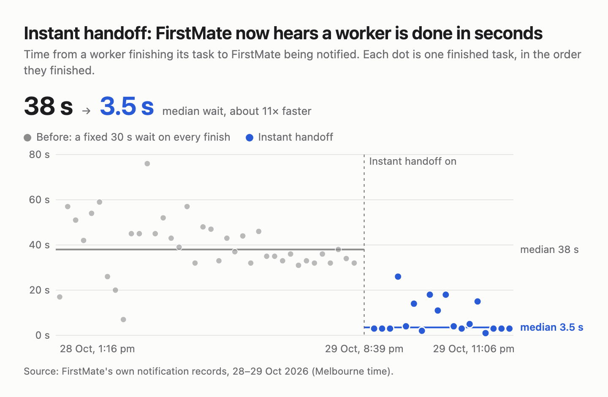
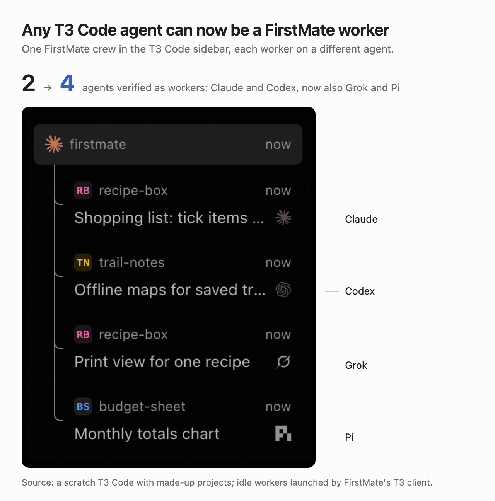

# What this fork adds

This fork of [kunchenguid/firstmate](https://github.com/kunchenguid/firstmate) regularly merges upstream's `main` and carries the changes below on top.
Each section says what the change does and why, with a picture where one shows it.
The [README](README.md) keeps a one-line summary of each.

## Instant handoff

When a worker reports that it is done, failed, blocked, or needs a decision, FirstMate hears about it within a few seconds.
Before, every finish waited out a fixed 30-second pause, so a finished worker typically sat unnoticed for 38 seconds.
That pause existed so a worker's last status line and the end of the same turn would cost FirstMate one wake instead of two.
FirstMate now acts on the status line at once and drops the trailing turn-end only when it can prove that turn ended cleanly with nothing new to report.
If the turn instead ends badly after a reported `done`, FirstMate is told once, naming the worker and what happened.
Routine `working:` notes keep the pause, where it still saves a wake.
Cleanup does not act early: it waits for a worker's running turn to finish rather than cutting it off.
This works on every backend, not only T3 Code.
Details: [signal coalescing and the terminal fast path](docs/watcher-continuity.md#signal-coalescing-and-the-terminal-fast-path).

## Any T3 Code agent can be a worker

On the T3 Code backend, FirstMate used to run only Claude and Codex workers.
Every worker needs its own environment and a note that its instructions really come from FirstMate, and only Claude and Codex could be given those through files in their folder.
Where a T3 Code build supports per-thread environment and instructions, FirstMate now sends both with the thread itself and reads them back to prove they took.
That opens the backend to every agent whose T3 Code driver takes those settings; Claude, Codex, Grok, and Pi are verified live; Cursor, Gemini, Kimi, and Devin go through the ACP registry, found by agent; and OpenCode 2 is refused until the T3 fork's per-session environment is installed.
On a T3 Code without per-thread settings, Claude and Codex keep the folder files, and any other agent is refused before anything starts rather than launched half-wired.
Details: [worker environment](docs/t3code-backend.md#worker-environment-and-channel-statement).

## Readable project and task titles

A new T3 Code project is titled with its folder name instead of `fm-<folder>`, and a worker's thread is titled with its task's title instead of an internal id.
The worker cards in T3 Code's sidebar then read as the project and the work.
Task titles are cut to 96 characters, so short titles read best.
Projects already in T3 Code keep their old titles, and FirstMate's own records still track each worker by its id, never by the title.
Details: [task lifecycle](docs/t3code-backend.md#current-lifecycle-and-safety).

## Full access and a clean stop

A T3 Code worker is refused unless it runs with full access, because a worker stuck waiting on an approval FirstMate cannot give would stall silently.
Cleanup uses T3 Code's own Stop, which also stops any tasks the worker started itself, instead of leaving them running after the worker is gone.
Details: [task lifecycle](docs/t3code-backend.md#current-lifecycle-and-safety).

## Recovery after a T3 Code restart

A T3 Code server restart ends every agent session it hosts at once, including FirstMate's own when it runs inside T3 Code.
FirstMate notices the restart at its next start and nudges each interrupted worker to check what is still running and report again.
The T3 Code fork tells a FirstMate running inside it that the server restarted, so FirstMate restarts its session once the server is back.
Details: [server restart](docs/t3code-backend.md#server-restart).

## Current T3 Code releases

T3 Code 0.1.3 renamed some of the tools FirstMate uses and changed how model options are listed.
FirstMate accepts both the old and the new forms, so it works with 0.1.3 and later as well as earlier builds.
Details: [capability gate](docs/t3code-backend.md#capability-gate).
