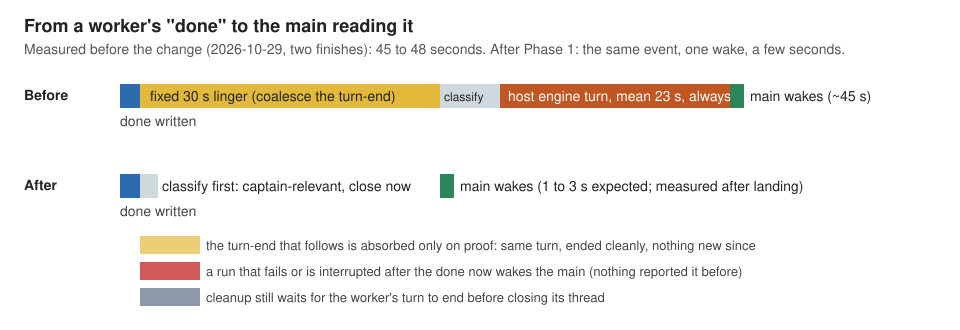
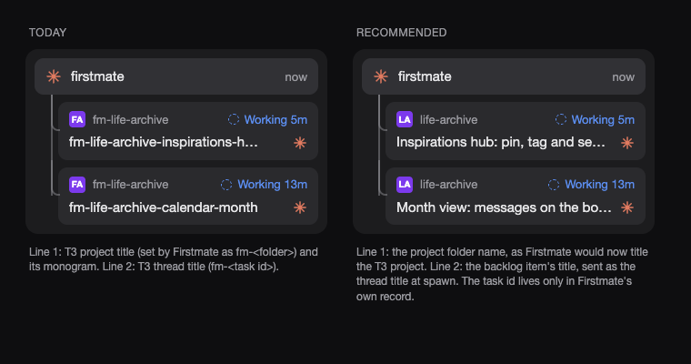
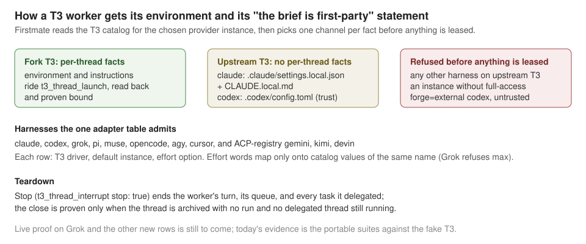
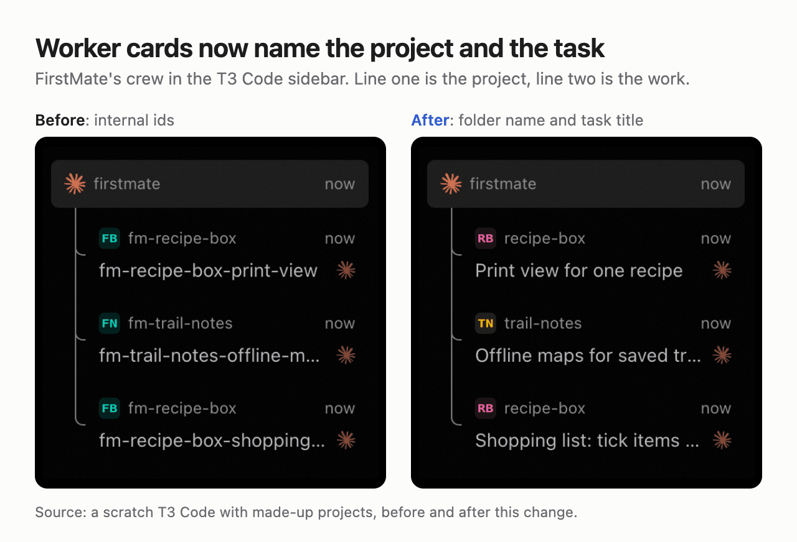
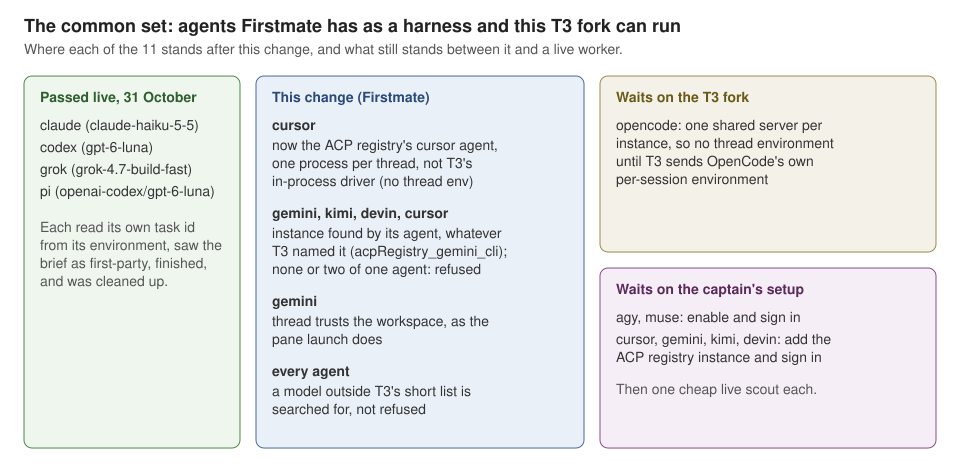
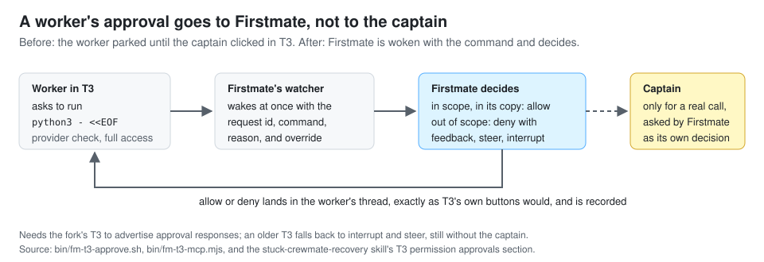
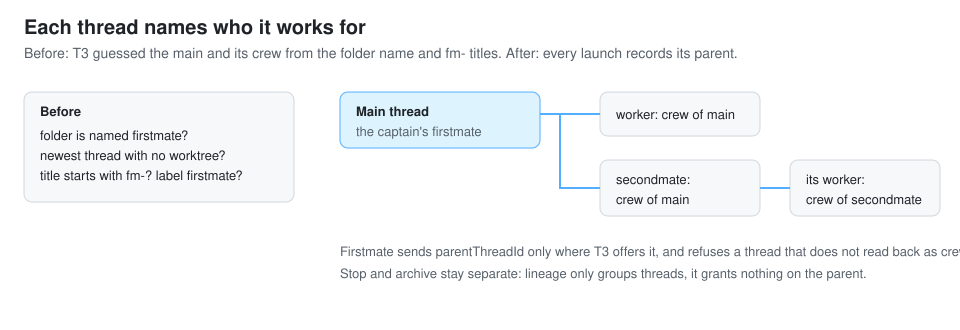
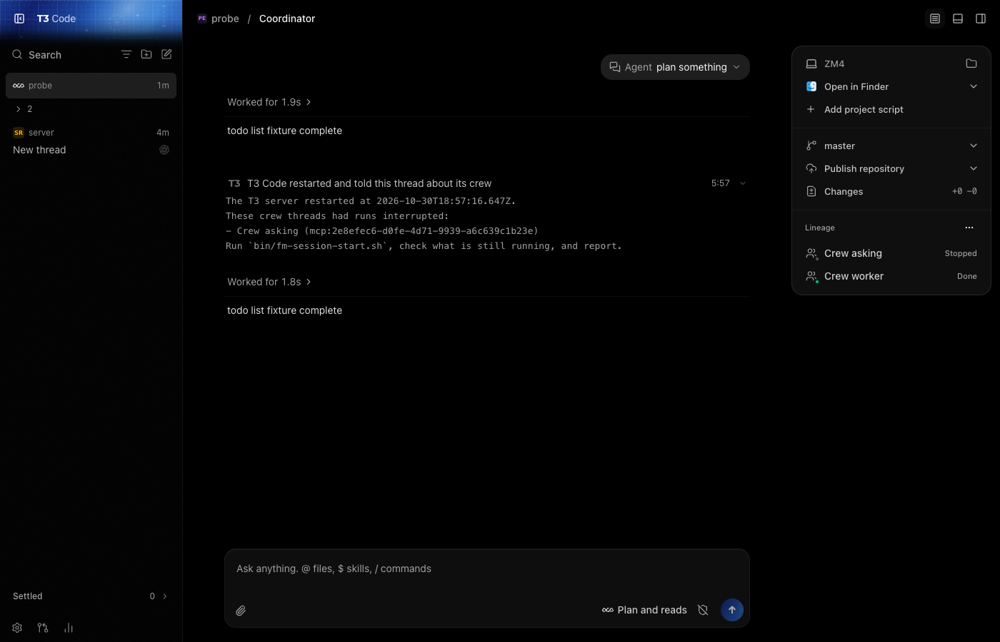
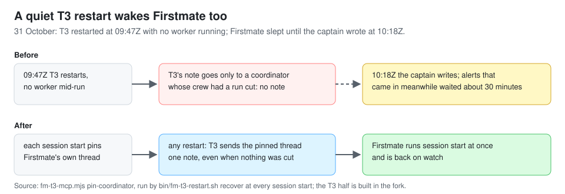
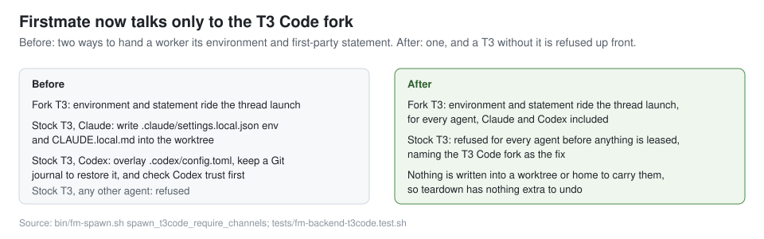

# Firstmate, as it changes

A working journal of the captain's Firstmate fork: what changed in how the ship runs, in the captain's words where he gave them, with the evidence from each round.
It is added to as the work goes.

## 1. The handoff gets fast, and stays careful (29 October 2026)

The question that started it:

> investigate if we can make sub agent handover a bit faster ... as a sub agent finishes first mate is able to like just read the output ... it's a sort of pub sub um one step after the other kind of speed
>
> — 29 October 2026

A read-only design pass timed the path from a worker's `done` line to the main being woken at 45 to 48 seconds.
Almost all of it was two waits: a fixed 30 second linger in the watcher, and a supervision-host engine turn that, for a finished worker, always handed the wake back to the main anyway.

He asked that the linger's author be read carefully before anything was removed:

> we would want to really try to understand the intention of the author because he designs things very carefully

The linger exists so that a worker's final status write and the same turn's turn-end hook, which land seconds apart, cost one main turn rather than two.
A second scout checked whether that trailing turn-end could ever carry a problem.
It cannot: it is an empty file whose only content is its timestamp, and a turn that fails never touches it.
But one real case in this home's own logs would have been hidden by a blind absorb: a worker that took on follow-up work after its `done`, whose only sign of finishing was that turn-end.

The principle he set:

> I think the optimal design here would be if something is over the line, like 80% of the time let's say then we do we there is a good enough argument to start taking action at that point but then there must be the ability for us to recover if the second event is also consequential. And if we can do both of these things, I would say we've strictly improved the system.

And on cleanup:

> Yeah, absolutely. I was thinking about this too. Act early but don't clean up until it's fully finished.

What was built, in his fork:

- The watcher classifies a new status span first. A `done`, `failed`, `needs-decision`, or `blocked` closes the cycle at once, with no linger. A `working:` note keeps the linger, where coalescing still saves a turn.
- At that moment the watcher records which turn wrote the event: the T3 run that was active, or the Claude busy record's sequence on a pane backend.
  The trailing turn-end is absorbed only when that proof holds end to end: same turn, ended cleanly, no status bytes and no steer since, and the worker's current state agrees.
  Anything unproven wakes the main exactly as a bare turn-end did before.
- A run that ends failed, interrupted, or cancelled after a surfaced `done` now wakes the main once, naming the task and the status, with T3's error message when it is readable.
  Nothing reported that before.
- A finished worker's wake goes straight to the main while the captain is present, instead of through the host's engine turn; the host keeps the routine and stale wakes.
- The cycle's wait now ends on the worker's own append, on every backend, so the poll interval is the backstop rather than the latency.
- Cleanup does not act early: before closing a T3 thread, teardown waits up to 30 seconds for a still-running turn to end, and refuses rather than interrupting it, unless forced.

The evidence is the regression suites, run under Bash 3.2 on the day of landing: the watcher, T3 backend, T3 client, branch dispatcher, away daemon, and supervision host suites, with new cases for every shape the scout listed.
The live measurement against the running home was deliberately left to Firstmate after landing, so no number from a real finish is claimed here yet.

## 2. Crew cards read like the work, not like the record (29 October 2026)

The ask, looking at the crew cards in T3's sidebar:

> I would like to get to a point, aesthetically speaking, where the first line is just the project that it's working on and then the second line is just the description without the machine readable names.
>
> (29 October 2026)

A scout traced both lines: the first is the T3 project's title, which Firstmate set to `fm-<folder>`, and the second is the thread's title, which was the task id.
The `fm-` prefix was doing real work in T3, though: the sidebar used it to tell Firstmate's crew apart from his own threads.
So the scout proposed three steps: teach his T3 fork to recognise crew by the client that launched them, give new projects and threads human titles, and retitle the existing projects.
His call:

> Um we can just do one and two of the recommended plan.

This entry is step two, the Firstmate half:

- A new T3 project is titled with the folder name, so its card reads `life-archive` and its monogram `LA`.
  Projects already in T3 keep the titles they have; retitling them was step three, which he left out, so today's `fm-life-archive` card stays as it is.
- A worker's thread is titled with its backlog item's title, cut to 96 characters with an ellipsis.
  When there is no item to read, it falls back to the old `fm-<id>`, and a second mate always keeps its `fm-<id>` title.
- The task id did not go anywhere: Firstmate's own record, cleanup, steering, and restart recovery still key on `fm-<id>` and the thread id, never on the title, so a title is only ever a label.
- A side effect worth knowing: the item title is now what he reads on the card, so short titles read best and the detail belongs in the item's notes.

This lands after the fork side is installed, because until the fork recognises crew by their launching client, a card without the `fm-` title would fall out of the crew tree.
The picture above is the scout's mockup, not a screenshot: no worker has launched with these titles yet.
The evidence is the T3 backend suite with new cases for the backlog title (quotes and accented text decoded, the 96-character cut, the fallback) and for a spawn whose thread carries that title while its record still reads `window=fm-<id>`.

## 3. Any agent can be a T3 worker, not only Claude and Codex (31 October 2026)

The ask:

> so far we only support Codex or Claude, right? We should really be able to support orchestration across any agent. Neither Firstmate or T three code s themselves stop this. So we have to figure out w why it's stopping us and what we can do to change that.
>
> Any agent build, yeah, let's go the full path

The investigation found the limit was Firstmate's own: three hard refusals, and under them folder-file tricks that only Claude and Codex read, standing in for a per-thread environment and per-thread instructions that T3 did not have.
"The full path" is two changes: the fork's T3 gains those two per-thread fields, and Firstmate switches to them.
This entry is the Firstmate half:

- One adapter table now decides which harnesses T3 can run: claude, codex, grok, pi, muse, opencode, agy, cursor, and the ACP-registry gemini, kimi, and devin, each with its T3 driver, default instance, and effort option.
- Where the T3 instance advertises the new fields, the worker's environment and its "the brief is first-party" statement ride the thread launch, for every harness, and Firstmate reads them back to prove they bound.
  Upstream T3 keeps today's Claude and Codex folder files; any other harness there is refused rather than launched half-wired.
- An instance that cannot run full-access is refused, and so is a thread T3 says it runs lower, because such a worker would stall on approvals Firstmate cannot answer.
- No pane-style hook files are written for the new harnesses, global ones such as Grok's included; T3's own thread status already tells Firstmate when a worker is busy or done.
- Teardown now uses T3's Stop, so a worker's own delegated T3 tasks stop with it instead of running on in a returned slot.
- A Codex ship on an external review forge is refused, not just warned, when its push guard could be ignored.

Nothing has run live yet: the evidence is the T3 backend and helper suites against the fake T3, with new cases for a Grok worker with no hook files, a server with and without the new fields, a downgraded instance, and a worker that owns a running child.
The first live proof is one cheap Grok scout once the fork's half is installed.

## 4. One picture per fork feature, and a README that says less (31 October 2026)

The ask, pointing at the instant-handoff chart:

> this is like super tight like one picture um super succinct no no garbage no no filler ... if we can produce a picture like this or a picture for every fork that would be great
>
> I also want each fork repo to get a full-blown fork.md ... which then frees up the the fork features in the main readme to be as simple as possible, like just dead simple.
>
> (31 October 2026)

What was built:

- `FORK.md` at the repository root, one section per fork feature: what it does, why, and a picture where one shows it.
- Three features got a picture: the instant-handoff chart, the readable crew titles above as a before and after, and one crew with Claude, Codex, Grok, and Pi workers side by side.
- Server-restart recovery, the full-access and clean-stop rule, and T3 0.1.3 support have nothing visible to show, so they have none.
- The README's fork section went from six long bullets to five short lines and a link to `FORK.md`.

The choices worth knowing:

- Both T3 pictures are real screenshots, not mockups, taken from the installed fork T3 run as three throwaway servers with made-up projects (`recipe-box`, `trail-notes`, `budget-sheet`) and idle worker threads launched by Firstmate's own T3 client.
  No prompt was sent, so no model was paid for, and nothing from his real T3 appears.
- Both are framed like the handoff chart: one title stating the result, one headline, the picture, a one-line source.
- The pictures live once, under `docs/media/fork/`, and this entry links to them rather than keeping a second copy.

## 4. The common set: every agent both sides already run (31 October 2026)

The ask, and the correction a moment later:

> Yeah, we just wanna support every like we wanna support the union set between First Mate and T three code
>
> Actually I don't know if it's a union set, but it's more like the common set
>
> (31 October 2026)

That is 11 agents.
Claude, Codex, Grok, and Pi already pass live as Firstmate workers in T3: each scout read its own task id from its environment, saw its brief as first-party, finished, and was cleaned up.
OpenCode and T3's own Cursor driver were refused, because neither can give a thread its own environment.

This entry is the Firstmate half of the plan:

- Cursor now runs as the ACP registry's `cursor` agent (`cursor-agent acp`), which T3 starts as one process per thread with that thread's environment.
  T3's in-process Cursor driver could only ever be refused.
- An ACP registry worker (Cursor, Gemini, Kimi, Devin) runs on whichever T3 instance reports that agent, whatever T3 named it.
  T3 names a new one after the agent, such as `acpRegistry_gemini_cli`, which the old table would have refused every time.
  An explicit instance mapping still wins, and two instances of one agent are refused rather than guessed.
- A Gemini thread trusts its workspace through its environment, as the pane launch already does.
- A model outside the short list T3 shows for an instance is now looked up in T3's full catalog before it is refused.
  That is the bug today's live checks hit with Codex `gpt-5.6-luna` and OpenCode `kimi-code/k3`.

The evidence is the T3 helper and backend suites against the fake T3.
The new cases cover a registry instance found by agent, the none and two-of-one-agent refusals, Cursor refusing T3's in-process driver, a Gemini spawn carrying the trust variable, and an omitted model found by search but a near-miss slug refused.
Today's four live passes are now in the verification record.
The remaining agents need the fork's OpenCode change or the captain's setup first, then one cheap live scout each.

## 6. A worker's approval comes to Firstmate, not to the captain (31 October 2026)

The ask:

> I mean if it needs my core, it needs my core, you know, like you should be able to escalate like the the worker should be able to escalate that issue to you and if you can't resolve it and it genuinely needs my call then you will present that decision as opposed to the worker presenting it like you should still be able to like kill it at the worker level or whatever you need to do and then represent the decision as you because the principle of first mate is I never need to interact with workers.

Even at full access, Claude still stops for some commands, such as `python3 - <<EOF`, and T3 shows that request only in its own window.
Firstmate could see that something was pending but could not answer it, so the worker waited for the captain to click.
The fork's T3 is gaining a way to answer these over Firstmate's connection; this entry is the Firstmate half:

- When a worker parks on an approval, Firstmate is woken at once with the request id, the command or file, the provider's reason, and whether a provider check or one of the captain's ask rules caused it.
- `bin/fm-t3-approve.sh` allows or denies it, with feedback the worker sees on a deny, and records every decision in the task's own record.
- The rule Firstmate follows: allow what stays inside the task and its own copy; deny with feedback, and steer or interrupt, what does not; only a call that genuinely needs the captain reaches the captain, asked as Firstmate's own decision, never as "go click in the worker's window".
- On a T3 without the new feature the helper refuses, and Firstmate interrupts and steers the worker instead, which also ends the wait without the captain.

The evidence is the T3 helper and backend suites against the fake T3, with new cases for an approval waking Firstmate with its command, an allow, a deny with feedback, an already-answered approval, and a T3 without the feature.
Nothing has run live yet; the first live proof is one approval on a worker once the fork's half is installed.

## 7. Crew threads name their coordinator (31 October 2026)

The ask:

> I want you to kind of go over my changes for T3 code and first mate like our fork changes ... think about the direction or the architecture or the approach ... whether or not it could be done sort of more elegantly because we've kind of like bolted on layers after layers of sort of changes ...

The architecture review found one place where the seam was wrong: T3's sidebar found Firstmate's main and crew by guessing from the folder name, the newest thread without a worktree, and `fm-` titles, and each Firstmate title change broke it.
Its first recommendation was one recorded field instead: each thread names the thread it works for when it is launched.
This entry is the Firstmate half; the fork's T3 is gaining the field in parallel.

- Every thread Firstmate launches in T3 names the thread running the Firstmate that spawned it: a worker under the main or under its secondmate, and a secondmate under the main.
- The parent is sent only where T3 offers the field, and a thread that does not read back as crew of exactly that parent is archived and refused, like any other wrong binding.
- On a T3 without the field, when Firstmate is not running in T3, or when the home has several live threads, the thread launches as before with no parent, so nothing stops working.
- The optional step of pinning the main at session start was left out: it would add a network call to every session start for a purely visual gain.

The evidence is the T3 helper suite (45 passing, with a new case for a parent bound, a wrong lineage, a wrong parent, an unknown parent, and a T3 without the field) and the T3 backend suite (119 passing, with new spawn cases for the home's main, an explicit target, an older T3, and a home with two live threads).
Nothing has run live yet; the first live proof is one spawn once the fork's T3 half is installed.

## 8. T3 wakes the main after a restart, so the outside nudge goes (31 October 2026)

The ask:

> I want you to kind of go over my changes for T3 code and first mate like our fork changes ... think about the direction or the architecture or the approach ... whether or not it could be done sort of more elegantly because we've kind of like bolted on layers after layers of sort of changes ...

A T3 restart ends the main's session along with every worker's, and nothing inside a dead session can wake it.
Until now a launchd job outside T3 polled the server every 30 seconds and sent the main one message per restart.
The architecture review's second recommendation was to let T3, which knows when it starts, say so itself; the fork's T3 now sends each thread with crew one note per server start (picture above, from that task's live probe).
This entry is the Firstmate half: the outside job, its launchd template, its records, its install and uninstall commands, and their docs are gone.

- The main's restart reminder is kept, against the review's plan to delete it.
  T3 skips the note for a main whose own turn the restart cut, and wakes it with "Continue where you left off." instead, which says nothing about session start; the reminder, which denies the first tool call while the lock names a dead process, is the only thing that sends that main to session start.
  The deletion is kept aside as a patch in case the captain wants it anyway.
- The credential guard in the same hook is unchanged, and `bin/fm-t3-restart.sh recover` still steers the interrupted workers once session start runs.
- The launchd job already installed on this Mac is left running until this lands; it is removed by hand afterwards.

The evidence is the T3 helper, away-daemon, turn-end guard, and T3 backend suites (44, 156, 91, and 113 passing), the linters, and the documentation check.
The note only reaches a main whose workers are recorded as its crew, which needs entry 7's Firstmate half to have landed.

## 9. A worker's approval wakes Firstmate even with Herdr workers in the home (31 October 2026)

The morning after entry 6 landed, a T3 worker hit a Claude safety check on an `rm` and sat on it for about 9 minutes; Firstmate only noticed through the general "worker has gone quiet" alert, without the command.
Asked whether to find out why and fix it with a test, the captain said:

> Yeah, investigate.

The cause was in Firstmate, not T3.
Entry 6's wake rides the watcher's T3 wait, and the watcher gave that wait to T3 only when no Herdr worker was recorded, so Herdr's own fast path was never slowed.
This home still records two parked Herdr workers, so no T3 worker's prompt was ever read; the old notes said T3 workers "stay on the poll loop", but the poll loop has no way to see a prompt.
The thread id and the installed T3 were both fine: the live T3 read the worker under its recorded id and lists approvals.

- Each cycle that waits on Herdr or Rex now first reads every T3 worker's pending prompts once, without waiting; against the live T3 that read takes 0.1 seconds for this home's five T3 workers.
- A prompt found there wakes Firstmate exactly as in a T3-only home: once per prompt, with the command, the reason, and how to decide it.
- Herdr keeps its wait, so nothing about Herdr workers changes.

The evidence is a new regression that adds one Herdr worker beside a T3 worker with a pending `rm` approval: it fails on the old watcher (no wake) and passes now (a wake on the first cycle, never repeated, Herdr's wait still run).
Replaying the watcher against copies of this home's live task records showed the same thing: before, only the two Herdr workers were handed to the wait; after, all five T3 workers are read first.

## 10. A quiet T3 restart wakes Firstmate too (31 October 2026)

Entry 8 moved the restart wake into T3, but its note only goes to a main whose crew had a run cut by the restart.
On 31 October T3 restarted at 09:47Z with nothing running, so no note went out, and the outside poller entry 8 removed could no longer cover it; Firstmate stayed asleep until the captain wrote at 10:18Z.
Firstmate proposed having T3 also send the main a short note after any restart, with a test, and the captain said:

> Yeah, go ahead on your proposed fix of send the main session a short note.

The fix has two halves built side by side, against one agreed interface: a thread can be pinned as its project's coordinator, and after every server start T3 sends each pinned coordinator exactly one note, listing any cut crew runs or saying in one line that there were none.
This is the Firstmate half:

- Every session start now pins this home's own T3 thread as its project's coordinator, the same thread the away daemon finds (the one live, worktree-less thread running in the home), so a secondmate pins its own thread too.
- It only does so when T3 says it supports the pin; an older T3 is asked nothing more, and nothing is printed.
- Pinning again each session start is harmless, and a pin that cannot be made (no thread found, two candidates, T3 unreachable) never stops session start.

The evidence is new fake-server cases for the pin (pinned and read back, an earlier coordinator unpinned, repeated, skipped on a T3 without the feature) and for session start's restart recovery (silent, repeated, skipped when the home's thread is ambiguous or T3 lacks the feature), which fails without the pin; the T3 helper and T3 backend suites pass (47 and 119), along with the linters and the documentation check.
The quiet-restart note only arrives once the T3 half lands in the fork.

## 11. Firstmate needs the T3 Code fork, and the stock-T3 fallback is gone (31 October 2026)

The question from the architecture review, and the answer:

> FirstMate: tie FirstMate to the T3 fork and drop the stock-T3 fallback?
>
> Yeah, we can tie it. We can drop the stock T three fallback
>
> (31 October 2026)

On a T3 without per-thread environment and instructions, Firstmate used to write a worker's environment and its "the brief is first-party" statement into files in its folder: Claude's local settings and a `CLAUDE.local.md`, and for Codex an overlay on `.codex/config.toml` with a private Git journal to restore it, guarded by a Codex trust check.
This fork only ever talks to the captain's T3 fork, which has both, so all of that was dead weight.

What changed:

- A T3 whose agent does not offer both per-thread settings is now refused for every agent, Claude and Codex included, workers and secondmates alike, before anything is leased, with a message that names the T3 Code fork as the fix.
- The folder-file writers, the Codex overlay script, the Codex trust check, and the refusals that protected a project's own `CLAUDE.local.md` and Codex config are deleted, along with their cleanup in teardown and in an aborted spawn.
- A secondmate's home now only gets the credential link, so that link is all its cleanup removes.
- About 375 lines of scripts went (the 161-line Codex overlay script among them), and the tests shrank by about 350 lines while keeping coverage: each fallback test became a check that stock T3 is refused, or that a project's own `CLAUDE.local.md` and Codex config are left exactly as found.

The trade-off, accepted: this fork can no longer run workers on stock T3 at all, and upstream Firstmate changes that touch the deleted lines will conflict when merged in.

The evidence is the T3 backend suite (108 passing), the T3 helper suite (45), the away-daemon suite (156), and the teardown safety suite (22), plus lint and the docs check.
The live check, a Claude and a Codex worker spawned on the fork's T3 still binding their environment and statement, is left to Firstmate.

## 12. No more false "telemetry is on" warning (1 November 2026)

> Sure assume default telemetry off

Every T3 spawn and control action checks whether the T3 server counts worker turns, and it treated a server without `T3CODE_TELEMETRY_ENABLED` as telemetry on, which was right for stock T3.
The captain's T3 fork defaults telemetry off, so the live server, with the setting simply absent, drew a false warning on every action.

Now an absent setting reads off; an explicit `true` (or any value other than false, 0, no or off) still reads on and warns, and a server whose process cannot be read still warns as unknown.
The evidence is the T3 helper suite, with the default case now expecting off and no warning and a new case expecting on plus the warning for a server started with telemetry enabled.
